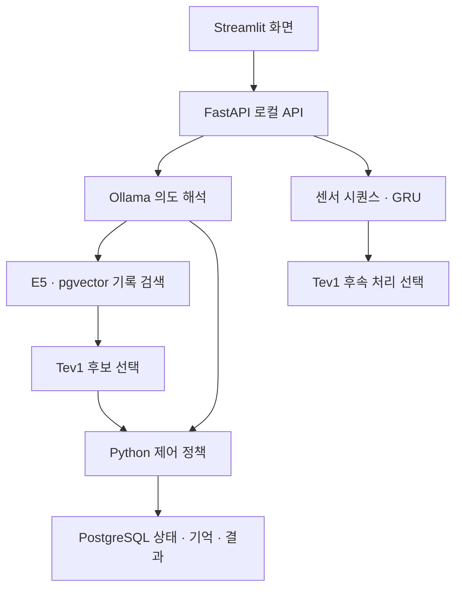

# Local AI Smart Home

> **프로젝트 보고서:** [보고서 다운로드 (PPTX)](SmartHome_Project_Report_Redesigned.pptx)

**사용자의 말과 과거 사용 기록, 센서 이벤트를 함께 활용하는 로컬 AI 스마트홈 MVP**입니다. 자연어로 가상 기기를 제어하고, 사용자별 기록에서 설정을 검색해 적용하며, 환경 센서의 시간 순서로 집 안의 활동을 추정합니다.

| 항목 | 내용 |
| --- | --- |
| 개발 기간 | **2026.11.10 ~ 2026.11.12** · MVP 구현 및 시연 기록 기준 |
| 프로젝트 목표 | 외부 AI API 호출 없이 동작하는 기기 제어·사용 기록 기반 개인화·센서 활동 인식의 연결 |
| 구현 형태 | Python/Jupyter 백엔드, FastAPI 로컬 API, Streamlit 시연 화면 |
| 시연 환경 | 같은 가상 집을 공유하는 사용자 A/B, 공간 8개, 가상 기기 10개, 센서 20개 |
| 데이터 | WSU CASAS Aruba 환경 센서 데이터, 사용자 A/B의 합성 사용 기록 56건 |
| 현재 범위 | 한 PC에서 실행하는 가상 기기 MVP |

## 프로젝트를 만든 이유

기기별 명령을 외우고 직접 설정하는 방식에서 한 걸음 더 나아가, “오늘 좀 쉬고 싶은데 조명을 어떻게 할까?”라는 요청을 사용자 자신의 사용 기록과 연결해 처리하고자 했습니다. 개인정보와 생활 기록을 로컬에 보관하면서도, 단순 대화에 머무르지 않고 실제 기기 상태 변경과 그 근거를 확인할 수 있도록 구성했습니다.

하나의 모델에 모든 판단을 맡기지 않고 역할을 나눴습니다. 로컬 LLM은 의도를 해석하고, 검색과 선택 모델은 개인화 근거를 고르며, **최종 제어 권한·기기 제약·작업 충돌은 Python 정책 코드가 검사**합니다. 활동 인식은 별도로 학습한 GRU가 센서 시퀀스에서 추론합니다.

## 주요 기능

| 기능 | 구현 내용 |
| --- | --- |
| 자연어 기기 제어 | 전원 켜기·끄기, 지원 조명의 밝기 조절, 제한 시간 동안 켜짐 유지 및 취소 |
| 사용자별 작업 보호 | A가 유지 중인 기기를 B가 끄거나 해당 유지 작업을 취소하는 요청 차단 |
| 사용 기록 RAG | E5 384차원 임베딩과 pgvector 코사인 거리 검색으로 해당 사용자의 기록 최대 12건 조회 |
| 개인화 즉시 적용 | 검색한 기록의 실제 `settings`를 후보로 만들고 Tev1이 문맥에 맞는 설정을 선택한 뒤 정책 검사와 함께 적용 |
| 기억 축적 | 성공한 명시적 요청을 새 사용 기록으로 저장. 자동 개인화의 결과는 별도 원천으로 기록하고 선호 검색에서 제외 |
| 센서 활동 인식 | 움직임·문 개폐 센서의 순서와 시간 간격으로 7가지 활동 추정. 입력 부족·낮은 확신은 판단 보류 |
| 근거와 처리 과정 표시 | 검색 원문, 선택한 기억·설정·시각, 정책 판단, 기기 적용, 기억 저장 결과를 화면에 표시 |
| 중복 실행 방지 | UUID 요청 ID로 확정 응답 재사용. 통신 실패 후 같은 ID로 결과 확인 |

휴식 시연의 A 30%·B 70%는 프로필에 고정된 분기가 아닙니다. 각 사용자에게 제공한 합성 휴식 기록 14건의 밝기 값이며, 검색 결과의 설정이 실제 후보와 적용값의 출처가 됩니다. 기록을 40%로 바꾼 격리 시연에서도 후보와 적용값이 함께 바뀌는 것을 확인했습니다.

## 기술 스택과 역할

| 구분 | 기술 | 역할 |
| --- | --- | --- |
| 언어·실험 | Python 3.12, Jupyter Notebook, NumPy | 데이터 처리, 모델 학습·추론, 실행 환경 |
| 로컬 Agent | Ollama, 사용자 등록 모델 `gemma4-ally` | 요청 해석과 구조화된 계획 생성, 32,768토큰 컨텍스트 예산 관리 |
| 선택 모델 | Transformers, `togethercomputer/Tev1-4B-experimental` | 개인화 후보 선택, HAR 후속 처리 선택 |
| 임베딩 | `intfloat/multilingual-e5-small` | 한국어 사용 기록과 질문을 384차원 벡터로 변환 |
| 활동 인식 | PyTorch, GRU, scikit-learn | 센서 임베딩과 이벤트 시퀀스를 이용한 활동 분류·평가 |
| API·화면 | FastAPI, Pydantic, Uvicorn, Streamlit | 로컬 API, 입력 검증, 가상 집·대화·시연 화면 |
| 저장소 | PostgreSQL 17, pgvector, Psycopg 3 | 기기·작업·요청 결과·개인 기억·벡터 검색 |
| 실행 | Docker Desktop, `pgvector/pgvector:pg17` | 로컬 PostgreSQL 컨테이너 및 영속 볼륨 |

로컬 확인 환경의 주요 버전은 PyTorch 2.15.0 CPU, Transformers 5.22.2, Streamlit 1.67.0, FastAPI 0.162.2, Psycopg 3.3.8, pgvector 확장 0.8.5입니다. 모델 다운로드는 명시적인 준비 단계에서 수행하고, 시연에서는 로컬 캐시와 로컬 Ollama를 사용합니다.

## 처리 구조



개인화 요청은 사용자별 검색 → 최근순 후보 구성 → 문맥에 맞는 후보 선택 → 기기 제약·작업 충돌 확인 → 기기 상태와 결과 저장 순서로 처리합니다. 검색된 최대 12건 안에서 적합한 최근 기록을 우선하므로, DB의 가장 최근 기록이 항상 검색에 포함되는 것은 아닙니다.

E5·Tev1 같은 무거운 연산 중에는 기기 쓰기 잠금을 유지하지 않습니다. 벡터를 먼저 준비한 뒤 기기·유지 작업·저장 가능한 기억·확정 응답을 짧은 트랜잭션에 반영합니다. DB 장애 시에는 롤백과 커밋 확인 불가를 구분해 표시합니다.

## HAR 데이터와 모델

CASAS Aruba의 센서 이벤트에서 활동 주석을 먼저 복원한 다음, **날짜 기준으로 학습 70%·검증 15%·테스트 15%를 분리**합니다. 각 구간 안에서만 과거 이벤트 창을 만들어 분할 경계를 넘는 시퀀스를 방지합니다. 전처리 사전과 시간 간격 처리값은 학습 구간에서 결정합니다.

- 입력: 센서 ID 임베딩 + 센서 상태 + 직전 이벤트와의 시간 간격
- 창 구성: 최근 10분, 최대 32개 이벤트, 최소 4개 이벤트
- 모델: 단방향 GRU → 7개 활동 분류
- 활동: 식사 준비, 식사, 휴식, 업무, 침실에서 화장실로 이동, 귀가, 외출
- 검증: 검증 Macro-F1로 가중치를 선택하고 같은 검증 구간에서 보류 임계값 결정
- 최종 모델: `aruba-gru-v3` · 출입문 `D001`·`D002`·`D004`를 가상 현관 `D001`로 통합

### 저장된 v3 평가 결과

아래는 **최종 v3 체크포인트에 저장된 테스트 보고 값**입니다. 원본 재학습이나 이번 게시 작업에서의 전체 모델 재평가 결과를 뜻하지 않습니다.

| 항목 | 값 |
| --- | ---: |
| 테스트 날짜 | 2011.05.10 ~ 2011.06.11 |
| 평가 대상 창 | 70,434 |
| 보류 적용 전 Macro-F1 | **0.8630** |
| 확신 부족 보류율 | 3.5835% · 2,524창 |
| 입력 부족 끝점 | 1,646 |

| 활동 | 테스트 창 수 | F1 |
| --- | ---: | ---: |
| 식사 준비 | 23,882 | 0.9564 |
| 식사 | 2,094 | 0.7627 |
| 휴식 | 42,368 | 0.9774 |
| 업무 | 1,788 | 0.9187 |
| 침실에서 화장실로 이동 | 95 | 1.0000 |
| 귀가 | 37 | 0.6591 |
| 외출 | 170 | 0.7668 |

한 가정·한 날짜 분할의 결과이며, 연속 창은 센서 이벤트를 공유합니다. 따라서 창 수를 독립된 활동 사례 수로 해석할 수 없습니다. 귀가·외출의 지원량은 작고 합성 시연 두 항목은 낮은 확신으로 보류된 기록이 있으므로, 실제 가정이나 다른 센서 배치에서의 일반화를 보장하지 않습니다. 기존 [HAR 튜닝 보고서](HAR_TUNING_REPORT.md)는 v1·v2 비교 기록이며, 입력 센서 매핑과 평가 창 수가 다른 v3의 결과와 구분해 읽어야 합니다.

## 트러블슈팅과 설계 개선

| 문제 | 원인·판단 | 적용한 해결 |
| --- | --- | --- |
| 귀가·외출의 학습 지원량 부족과 시연 오분류 | 실제 외부 출입 이벤트 상당수가 `D004`에 있었으나 가상 현관은 `D001` 하나여서 학습 입력과 시연 배치가 어긋남 | 활동 주석 복원 후 외부 문 3종을 하나로 대응하고, 시각·상태·원본 순서·중복은 보존한 채 v3 재학습. 매핑을 체크포인트에 저장하고 호환성 검사 |
| 반복 실행 후 모델 지연·시간 초과 | 서버 종료 후 모델 참조가 남거나 CPU·RAM 압박으로 추론 준비가 지연됨 | 모델을 서버 시작 때 순차 준비하고 준비 상태를 표시. E5 객체 재사용, CPU 스레드 제한, 종료 큐에서 가중치 해제. 요청 마감 초과 시 실행 보류 |
| 검색 결과와 무관한 개인화 값 적용 위험 | 프로필의 고정 숫자를 쓰면 RAG 검색이 실질적인 설정 근거가 되지 않음 | 고정 선호값·대체값 제거. 검증된 기억 한 건의 `device_id`와 `settings`를 후보·선택 근거·실행값까지 연결 |
| 반복 횟수가 최근 의도를 덮는 문제 | 과거 설정의 빈도를 우선하면 최근에 바꾼 설정을 반영하기 어려움 | 유사도 상위 12건 안에서 기록별 설정·시각을 유지하고 최근 적합 기록 우선. 실제 40% 요청 저장 후 이전 30% 반복 기록보다 우선하는 격리 시연 확인 |
| 통신 재시도에 따른 중복 제어·기억 저장 | 클라이언트가 응답을 받지 못해도 서버에서는 커밋됐을 수 있음 | 사용자·UUID·원문을 함께 검증하고 확정 응답 재사용. 같은 ID의 질문 변경은 HTTP 409, 커밋 불명확 상태는 같은 ID로 확인 |
| 다른 사용자의 작업 덮어쓰기 | 공용 기기는 공유되지만 유지 작업은 요청자의 의도를 보호해야 함 | 기기 잠금과 서버 정책으로 활성 유지 작업·소유자·만료를 검사하고, 다른 사용자의 중단 요청 차단 |

## 실행 방법

Windows·Python 3.12·Docker Desktop·Ollama 환경에서 개발했습니다. 노트북이 백엔드 실행 진입점이며, 저장소를 복제하는 것만으로 외부 모델·데이터·Ollama 등록 모델이 자동 준비되지는 않습니다.

### 1. Python 환경

```powershell
python -m venv .venv
.\.venv\Scripts\python.exe -m pip install -r requirements.txt
```

VS Code 또는 Jupyter에서 이 가상환경의 Python 커널로 `smarthome.ipynb`를 엽니다. 현재 작업 경로는 저장소 루트로 둡니다.

### 2. 모델·데이터 준비

1. Docker Desktop과 Ollama를 실행합니다. Ollama에는 **`gemma4-ally`라는 이름으로 등록된 호환 모델**이 필요합니다. 이 이름은 개발 PC의 사용자 정의 등록명이며 저장소에는 해당 Ollama 모델 파일·Modelfile이 포함되지 않습니다. 다른 환경에서는 모델 등록과 템플릿·토큰 계수 경로를 준비해야 합니다.
2. 첫 모델 준비 때만 커널 시작 전 `SMART_HOME_PREPARE_MODELS=1`을 설정하고 노트북의 모델 캐시 다운로드 셀을 실행합니다. E5·Tev1을 고정 리비전으로 받은 뒤 환경 변수를 해제합니다.
3. HAR 재학습이 필요하면 주석이 있는 CASAS Aruba 원본을 `data/aruba/data.txt`에 준비하고 학습 셀의 안내를 따릅니다. 이미 준비된 v3 체크포인트를 사용하는 시연에서는 재학습을 건너뜁니다.
4. 개인화 더미를 처음 준비할 때는 공통 설정의 `SMART_HOME_PREPARE_MEMORIES = 1`로 기억 준비 셀을 실행한 뒤 `0`으로 되돌립니다. 사용자 A/B의 2주 합성 기록 56건을 사용합니다.

E5·Tev1의 실제 가중치를 사용하는 시연에는 충분한 RAM이 필요합니다. 개발 기록의 16GB RAM·CPU 환경에서는 Tev1 선택에 약 59~94초가 관측됐으며, 메모리 압박 시 시간 초과로 보류될 수 있습니다.

### 3. 백엔드와 화면 시작

노트북에서 공통 설정·레지스트리·정의 셀 → PostgreSQL 준비 → HAR v3 로드 → 모델·API 정의 → **로컬 API 시작과 모델 준비** 순서로 실행합니다. `/health`와 시작 셀 출력에서 서비스 준비 결과를 확인합니다. 종료 셀은 시연을 마친 뒤 실행합니다.

별도 터미널에서 화면을 엽니다.

```powershell
.\.venv\Scripts\python.exe -m streamlit run streamlit_smarthome.py --server.address 127.0.0.1
```

- API: `http://127.0.0.1:8000`
- 화면: `http://127.0.0.1:8501`
- DB: `127.0.0.1:5432`, 데이터베이스 `smart_home`

DB 준비 셀은 PostgreSQL 컨테이너·영속 볼륨과 누락된 앱 시드를 준비하고 기존 상태를 보존합니다. 최초 비밀번호는 난수로 생성해 저장소 밖 사용자 프로필에 보관합니다. 일반 실행에서는 `SMART_HOME_RESET_DEMO_DATA = 0`을 유지합니다. 해당 스위치는 다섯 앱 테이블을 재생성하는 명시적 초기화 전용입니다.

### 4. 확인과 종료

```powershell
.\.venv\Scripts\python.exe smarthome_validation.py --check
.\.venv\Scripts\python.exe smarthome_validation.py --list
```

`--check`는 소스 구성·Python 구문·노트북 형식·코드 셀 설명을 확인합니다. 모델·DB 통합 시연은 API와 Streamlit을 시작한 뒤 `--screen` 또는 노트북에서 불러온 검증 함수를 명시적으로 실행합니다. 기존 검증 파일에는 과거 계약의 회귀 함수와 관측 기록도 포함되어 있습니다.

시연 종료 시 Streamlit 터미널에서 `Ctrl+C`, 노트북에서 `stop_api()`를 실행합니다. DB 컨테이너까지 정지하려면 `docker stop smart-home-db`를 사용합니다.

## 파일 안내

| 경로 | 내용 |
| --- | --- |
| [smarthome.ipynb](smarthome.ipynb) | 데이터 준비, HAR 학습·평가·추론, 모델 어댑터, 정책, RAG, 로컬 API |
| [streamlit_smarthome.py](streamlit_smarthome.py) | 사용자 전환, 가상 집 상태, 대화·개인화·센서 시연 및 처리 과정 표시 |
| [smarthome_validation.py](smarthome_validation.py) | 검증 함수, 대역, 격리 DB 도우미, 날짜별 구현·실행 관측 기록 |
| [SMART_HOME_MVP_DESIGN.md](SMART_HOME_MVP_DESIGN.md) | MVP 범위와 정책·API·개인화 계약 |
| [HAR_TUNING_REPORT.md](HAR_TUNING_REPORT.md) | 이전 v1·v2 HAR 튜닝·검증 기록 |
| [SmartHome_Project_Report.pptx](SmartHome_Project_Report_Redesigned.pptx) | 프로젝트 소개·구조·모델 평가·시연·트러블슈팅 발표 자료 |
| [data/demo/smart_home_usage_history_dummy.json](data/demo/smart_home_usage_history_dummy.json) | 개인정보가 아닌 합성 사용 기록 56건 |
| `data/har/aruba-gru-v3.pt` | 로컬 학습한 v3 가중치·전처리·평가 메타데이터 |
| `data/aruba/`, `data/models/` | 별도로 준비하는 원본 데이터와 외부 모델 캐시 · Git 제외 |

## 검증 기록과 범위

2026.11.12 구현 기록에는 실제 Gemma·E5·Tev1·Docker PostgreSQL·API와 Streamlit AppTest를 연결한 기기 제어, A/B 휴식 개인화, 야간 작업, 근거 부족, HAR 휴식, 요청 재전송과 화면 결과 보존 확인이 남아 있습니다. 합성 기록을 40%로 바꾼 검증과 실제 명시적 요청의 기억 축적·최근 설정 우선 선택은 격리 DB에서 확인했습니다. 구체적인 관측과 미실행 범위는 검증 파일 끝의 날짜별 기록을 참고할 수 있습니다.

현재 A/B 선택은 시연용 프로필 구분이며 실제 로그인·인증 기능이 아닙니다. 실기기 연동, Home Assistant, 외부 LLM의 MCP 접근, 반복 자동화와 센서로 특정 거주자를 식별하는 기능은 후속 설계 범위입니다. 현재 HAR 결과는 집 전체 활동 추정이며 특정 사용자에게 귀속하지 않습니다.

## 데이터·모델 출처

- [WSU CASAS 데이터셋](https://casas.wsu.edu/datasets/) — Aruba 환경 센서·활동 주석. 원본 안내는 CASAS 연구팀의 명시적 허가 없는 재배포를 제한하므로 원본 데이터는 저장소에 포함하지 않습니다. 사용 시 WSU CASAS 및 D. Cook, *Learning setting-generalized activity models for smart spaces*, IEEE Intelligent Systems, 2011을 인용해야 합니다.
- [Tev1-4B-experimental](https://huggingface.co/togethercomputer/Tev1-4B-experimental), [multilingual-e5-small](https://huggingface.co/intfloat/multilingual-e5-small) — 외부 모델은 각 모델 카드와 이용 조건에 따라 별도로 준비합니다.
- [Ollama](https://ollama.com/), [pgvector](https://github.com/pgvector/pgvector) — 로컬 추론과 벡터 검색에 사용했습니다.
