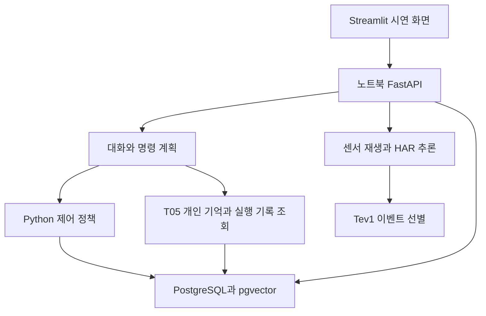

# 로컬 AI 스마트홈 MVP 구현 설계서

이 문서는 Codex가 Smart_home 저장소에서 구현할 MVP의 범위와 인수 기준을 정의한다. 전체 시스템 설계서 v0.3의 로컬 Agent, 사용자별 작업과 기억, 환경 센서 HAR 방향을 따른다. 이번 구현의 기준은 이 문서와 [AGENTS.md](AGENTS.md)다.

현재 목표는 3일 안에 만든 로컬 MVP에서 기능을 화면으로 확인하는 것이다. 이번 작업의 완료 판단은 §7의 짧은 시연 확인을 따른다. 이미 동작하는 모델·DB·제어 경로를 재사용하고, 새 작업은 기록의 실제 설정을 사용하는 RAG 개인화, 명시적 사용자 요청의 기억 축적, Streamlit의 근거·처리 과정 표시에 집중한다. 고정된 사용자별 선호 밝기는 사용하지 않는다. 본문에 남은 상세 회귀·장애·마이그레이션 시험은 관련 문제가 재현될 때 참고한다.

이번 수정 구현에서는 사용자가 승인한 대로 로컬 `smart_home`의 기존 앱 데이터를 한 번 삭제하고, 현재 스키마와 새 더미 56건을 다시 준비한다. 초기화는 §6.1, 자연어 기기 제어 의도 확인·과거 참조는 §4.3–§4.4, 화면은 §6.2, 완료 판단은 §7을 따른다. 이후 일반 실행에서는 데이터를 보존한다.
사용자별 합성 사용 기록을 활용하는 개인화 시연은 §4.1과 §7.1을 따른다.
후속 보완은 과거 기록의 조회 순서, 요청 접수 시각과 마감, 모델 응답 파싱, 개인 기억의 기기 ID 보존, §3.1의 Aruba 문 센서 대응을 포함한다.

## 1. 범위와 산출물

- 한 PC에서 로컬 Ollama, 노트북 백엔드, Streamlit을 실행한다. Python이 가상 집의 기기 상태, 센서 이벤트, 작업을 관리하며 A와 B가 같은 가상 집을 공유한다.
- HAR은 CASAS Aruba로 학습한 모델 A 한 개를 사용한다. 운영 시연에는 합성 센서 이벤트를 주입한다. 사용자의 성공한 명시적 기기 요청과 개인화 실행은 §4.7에 따라 기억에 자동 저장한다. 외부 LLM MCP, 실물 Home Assistant, 실기기, 센서만으로 선호를 학습하는 기능, 반복 자동화와 모델 B는 후속 범위다.
- 구현 소스는 아래 세 파일에 둔다. 원본 데이터셋, 체크포인트와 모델 캐시는 로컬 파일로 관리한다. 앱의 저장소는 로컬 Docker 컨테이너의 PostgreSQL과 pgvector를 사용하며, 데이터베이스 이름은 `smart_home`이다. 설치 방법, 데이터 준비, 실행과 종료, 검증 기록은 노트북에 둔다.

| 파일 | 담당 |
| --- | --- |
| `smarthome.ipynb` | 데이터 준비, HAR 학습·평가·저장·추론, 모델 어댑터, 가상 기기·작업·기억·Agent, 로컬 API |
| `streamlit_smarthome.py` | A/B 전환, 대화, 가상 집과 기기 상태, 센서·HAR 시연, 사용 기록 임베딩 검색과 개인화 설정 적용 시연, 실행 로그 표시 |
| `smarthome_validation.py` | 검증 함수, 테스트 대역, 격리 DB 도우미, 정적 확인과 명시적 시연 검증 |

**최종 소스 산출물은 위 세 파일로 관리한다.** 검증 전용 코드는 `smarthome_validation.py`에 둔다. 검증 파일을 불러오는 것만으로 테스트를 자동 실행하지 않는다. 노트북의 런타임/API 정의를 준비한 뒤 `%run -i smarthome_validation.py`로 불러와 필요한 함수만 호출한다. 터미널의 정적 확인은 `.venv\Scripts\python.exe smarthome_validation.py --check`를 사용한다. 구현·리뷰 루프의 임시 실행 스크립트, 단계별 인계 기록과 로그는 저장소 밖 임시 디렉터리에서 관리한다.

노트북의 **모든 코드 셀 바로 앞**에 해당 셀의 목적, 주요 입력과 결과를 설명하는 한국어 Markdown 셀을 둔다. 첫 실행용 준비·학습 경로와 기존 HAR 아티팩트로 시연하는 경로를 분리한다. 데모 시작은 명시적으로 실행하는 셀에서 제어하고, Streamlit 재실행으로 학습이나 상태 초기화가 일어나지 않도록 한다.

### 1.1 구성과 책임



- Streamlit은 프로필 선택, 사용자 입력, 조회 결과를 표시한다. FastAPI는 프로필을 확인하고 모델 호출, 가상 기기 제어, 응답 조립을 담당한다.
- `gemma4-ally`가 요청을 해석한다. 직접 제어와 과거 실행 기록을 참조한 제어는 현재 문장의 실행 의도를 재확인한다. 개인화 요청은 사용자 기록 조회와 Tev1의 후보 선택 뒤 Python 제어 정책을 거쳐 같은 요청에서 바로 적용한다. HAR 시연은 별도 경로에서 집 전체의 활동을 추정하며 Tev1은 HAR 후속 처리도 고른다.
- 처음에는 노트북에서 DB 준비 → HAR 학습·저장 또는 체크포인트 로드 → 백엔드 시작 순서로 실행한다. 체크포인트가 없으면 HAR 준비 상태를 `unavailable`로 표시하고 대화와 기기 시연은 진행한다. 이어서 별도 터미널에서 Streamlit을 시작한다. 준비 셀을 다시 실행하면 같은 컨테이너와 저장 상태를 재사용한다.

## 2. 가상 집

중앙 복도를 기준으로 왼쪽에 주방·식당·거실, 오른쪽에 서재·침실·화장실을 둔다. 현관은 복도 남쪽 끝에 연결한다. 이 구조는 시연용 가상 평면이며, 센서 ID와 공간의 대응은 Aruba 공개 배치도를 참고했다.

| 왼쪽 | 중앙 통로 | 오른쪽 |
| --- | :---: | --- |
| 주방 | 복도 | 방 2 · 서재 |
| 식당 | 복도 | 방 1 · 침실 |
| 거실 | 복도 | 화장실 |
|  | 현관 ↓ 집 밖 |  |

| 공간 | 제어 기기와 내부 ID | 가상 센서 ID |
| --- | --- | --- |
| 주방 | 전등 `kitchen.light`, 환풍기 `kitchen.fan` | `M015`, `M017`, `M018` |
| 식당 | 전등 `dining.light` | `M013`, `M014` |
| 거실 | 전등 `living.light`, 선풍기 `living.fan` | `M009`, `M010`, `M012` |
| 복도 | 전등 `hall.light` | `M006`, `M008`, `M021` |
| 방 2 · 서재 | 스마트 플러그 `office.plug` | `M025`, `M026`, `M028` |
| 방 1 · 침실 | 전등 `bedroom.light`, 스탠드 `bedroom.lamp` | `M001`, `M002`, `M003` |
| 화장실 | 환풍기 `bath.fan` | `M004` |
| 현관 | — | `M011`, `D001` |

- `M` 센서는 움직임의 `ON/OFF`, `D001`은 현관문의 `OPEN/CLOSE`를 기록한다. 센서 이벤트 최소 필드는 `timestamp`, `sensor_id`, `state`다. 운영 로그에 필요하면 `source`를 별도로 붙인다.
- 10개 기기는 모두 전원 상태를 가진다. 거실과 방 1 전등은 켜져 있을 때 밝기 1–100%를 지원한다. 장치별 허용 동작은 서버 레지스트리에 선언하고 A와 B에게 같은 제어 권한을 준다. 초기 전원 상태는 모두 꺼짐이다.
- 장치 제어 결과와 센서 관측은 별도 이벤트다. 전등이 켜졌다는 기록이나 대화의 사용자 ID를 HAR 입력에 섞지 않는다.

## 3. HAR 학습과 시연

### 3.1 Aruba 원본과 모델

1. 기본 입력을 `data/aruba/data.txt`로 제시하고 경로를 변경할 수 있게 한다. 원본 파일의 출처, 판본, 필드와 활동 주석 유무를 먼저 확인한다. 원본 Aruba의 주석 파일 또는 검증된 주석 동등본을 사용한다. 공식 통합 아카이브를 사용할 때도 Aruba 파일에 활동 주석이 있는지 확인한다. 주석이 없거나 검증할 수 없으면 학습 단계에서 필요한 파일을 명시한다.
2. 시각, 센서 ID, 상태와 선택적인 활동 시작·종료 주석을 파싱한다. 센서 필터링 전에 원본 전체에서 활동 구간을 복원한다. 주석 공백과 다중 활동이 겹친 부분은 별도 집계한다. 이벤트 수, 파싱 실패 수, 센서별 등장 수, 라벨별 지원량과 날짜 범위를 출력한다.
3. 원본 날짜를 시간순으로 학습·검증·테스트로 먼저 나눈다. 이후 각 구간에서만 과거 이벤트 창을 만들고, 구간을 가로지르는 창은 제외한다. 최근 창의 마지막 시점에 유효한 활동 주석을 정답으로 삼는다. 미주석, 모호한 중첩, 미지원 활동은 지도학습 타깃에서 제외하고 개수를 보고한다. 모델의 판단 보류는 별도 상태로 관리한다.
4. 표의 20개 센서에 대해 위치와 학습 구간 출현 여부를 확인한다. 사용하는 원본 판본이 ID를 바꾼 경우 문서화된 메타데이터로 대응시킨다. 학습·검증·테스트·시연에 공통 전처리를 적용하고, 학습 구간으로 센서/상태 사전과 시간 간격 처리값을 맞춘다. 확인되지 않은 ID는 개별 매핑을 지어내지 말고 입력 품질 문제로 기록한다.
5. **센서 ID 임베딩 + 상태 + 이전 이벤트와의 시간 간격 → GRU → 활동 분류**를 PyTorch로 구현한다. 시연 대상 활동은 식사 준비, 식사, 휴식, 업무, 침실에서 화장실로 이동, 귀가, 외출이다. 실제 라벨 문자열은 원본에서 확인해 화면 이름과 대응시킨다. 학습 지원량이 없는 활동은 해당 판본의 누락으로 기록하고 시연에서 지원 불가를 표시한다.
6. 창 길이, 시드, 분할 날짜, 학습 설정, 최소 이벤트 수, 입력 유효시간과 보류 임계값을 노트북 설정 셀에 모은다. 설정·임계값 선택에는 검증 구간을 사용한다. 테스트에서 Macro-F1, 활동별 표본 수와 F1, 혼동행렬, 보류율을 보고한다. 이 MVP는 수치 합격선을 두지 않는다.
7. 가중치와 함께 센서/상태 사전, 라벨 매핑, 시간 간격 처리, 창 설정, 보류 기준과 모델 버전을 저장한다. 시연 때 이 설정으로 복원하고, 체크포인트 누락이나 버전 불일치는 화면에 표시한다.

가상 집은 외부 출입문이 한 개이므로 Aruba의 외부 출입문 센서를 하나의 가상 현관 센서 `D001`로 통합한다. Aruba 배치도의 정문 `D001`, 뒷문 `D002`, 차고 쪽 출입문 `D004`를 같은 역할로 대응시킨다. 아래 규칙은 데이터 출처별로 적용한다.

| 입력 출처 | 원본 센서 | HAR 입력 센서 |
| --- | --- | --- |
| Aruba 데이터셋 | `D001` · 정문 | 가상 집 `D001` |
| Aruba 데이터셋 | `D002` · 뒷문 | 가상 집 `D001` |
| Aruba 데이터셋 | `D004` · 차고 쪽 출입문 | 가상 집 `D001` |
| Aruba 데이터셋 | 그 밖의 등록 대상 센서 | 기존 센서 ID 유지 |
| 가상 집 시연 | `D001` | 가상 집 `D001` 유지 |

원본 센서 ID와 활동 주석을 보존해 활동 구간을 먼저 복원한다. 그 뒤 Aruba 입력을 정규화하고 등록 센서 필터, 센서 사전, 시간 간격과 창을 구성한다. 같은 대응을 학습·검증·테스트에 적용한다. 원본 ID는 품질 집계용으로 보존하고 HAR 입력에는 가상 ID를 사용한다. 시연 입력은 이미 가상 집 ID이므로 그대로 사용한다.

통합 시 각 원본 이벤트의 시각·상태와 동일 시각의 원본 순서를 유지한다. 통합 뒤 같은 센서·상태가 연속하더라도 이벤트를 삭제하거나 OPEN/CLOSE가 교대로 나타나도록 재작성하지 않는다. 각 구간의 가상 `D001` 이벤트 수는 원본 `D001`, `D002`, `D004`의 유효 OPEN/CLOSE 이벤트 수 합과 일치해야 한다. 원본과 변환 후 센서별 이벤트 수, 귀가·외출의 유효 학습 창 수를 각각 보고한다.

센서 대응을 바꾸면 입력 시퀀스와 센서 임베딩의 의미가 달라지므로 재학습한다. 대응 규칙을 체크포인트 메타데이터에 저장하고 모델 버전과 저장 경로를 갱신한다. 기본 로드 경로는 새 대응 규칙과 일치하는 모델만 사용한다. 새 파일이 없거나 대응 규칙이 불일치하면 HAR을 `unavailable`과 원인으로 표시한다. 기존 v1·v2는 명시적으로 선택하는 비교용 경로에서만 사용한다.

**구현 기본값.** 날짜가 같은 이벤트는 한 구간에 두고 날짜 수 기준으로 처음 70%를 학습, 다음 15%를 검증, 마지막 15%를 테스트로 나눈다. 주석 시작 행부터 종료 행까지 해당 활동을 적용하고, 같은 시각의 행은 원본 순서를 보존한다. 표에 있는 센서 가운데 학습 구간에서 확인한 센서를 학습과 추론의 공통 입력으로 사용한다. 유효한 센서 이벤트는 주석 여부와 별개로 입력 창에 들어갈 수 있다. 창 끝의 활동이 하나로 확인되는 경우에만 정답을 부여한다.

창의 마지막 이벤트를 기준으로 그 이벤트까지의 최근 10분, 최대 32건을 사용한다. 유효 이벤트가 4건보다 적으면 판단을 보류한다. 시간 간격은 초 단위로 계산한다. 길이가 다른 창을 배치로 묶을 때는 뒤쪽에 패딩하고 실제 길이로 GRU 출력을 구한다. 모델 설정은 노트북에서 관리한다. 기본값을 조정할 때는 학습과 검증 구간을 사용하고 테스트 평가 전에 적용값을 확정한다. 테스트의 F1과 혼동행렬은 입력 조건을 충족하고 정답이 있는 창 전체에서 보류 적용 전 예측으로 계산한다. 보류율과 입력 조건을 충족하지 못한 건수는 따로 표시한다.

### 3.2 합성 이벤트 프리셋

아래는 센서 경로 예시다. 구현 시 정상 프리셋은 시간 간격과 상태 변화를 가진 재현 가능한 이벤트열로 만든다. 귀가·외출처럼 짧은 동작은 유효한 가변 길이 창으로 받거나 앞선 움직임 이벤트를 보강해 최소 길이를 충족시킨다. 활동의 기대 이름은 화면과 검증 기록에만 두며 HAR과 T06에는 이벤트 및 실제 추론 결과만 전달한다.

| 프리셋 ID | 화면 표시 | 합성 이벤트 순서 |
| --- | --- | --- |
| `meal_preparation` | 식사 준비 | 복도 `M008` → 주방 `M015` → `M017`·`M018` 교대 감지 |
| `eating` | 식사 | 주방 `M015` → 복도 `M008` → 식당 `M014`·`M013` 간헐 감지 |
| `relax` | 휴식 | 복도 `M006` → 거실 `M012`·`M009` → `M010` 간헐 감지 |
| `work` | 업무 | 복도 `M021` → 서재 `M028` → `M025`·`M026` 간헐 감지 |
| `bed_to_toilet` | 침실에서 화장실로 이동 | 침실 `M002`·`M003` → 복도 `M006` → 화장실 `M004` |
| `enter_home` | 귀가 | `D001 OPEN` → 현관 `M011` → `D001 CLOSE` → 복도 `M006` |
| `leave_home` | 외출 | 복도 `M006` → 현관 `M011` → `D001 OPEN` → `D001 CLOSE` |
| `insufficient_events` | 센서 입력 부족 | 침실 `M001` 이벤트 한 건. 최소 입력 기준에 걸려 판단 보류 |

프리셋마다 독립된 최근 이벤트 창을 사용한다. 합성 타임스탬프는 시연 기준 시각을 끝점으로 맞춘다. 모델이 다른 활동을 내거나 보류하면 그대로 표시한다. HAR 응답에는 상태, 추정 활동 또는 보류 이유, 관측 시작·끝 시각과 모델 버전을 포함한다. 추정 범위는 집 전체이며, A/B 가운데 특정 거주자에게 귀속하지 않는다.

## 4. 로컬 Agent와 개인화

| 역할 | 처리 |
| --- | --- |
| 중앙 Agent · T01 상태 분석 · T02 계획 | 사용자가 로컬 Ollama에 등록한 `gemma4-ally`를 사용한다. Agent가 필요한 상태를 요약하거나 구조화된 작업 후보를 만든다. 알 수 없는 대상이나 의도는 확인 질문으로 처리한다. |
| T03 충돌 | 서버 코드가 활성 작업, 소유권, 기기 제약을 검사하고 충돌 원인을 반환한다. `gemma4-ally`는 필요할 때 근거를 사용자에게 설명한다. |
| T04 개인화 후보 선택 | 사용자별 기억에서 휴식 조명이나 야간 작업 준비처럼 요청에 맞는 실행 후보를 만들고 로컬 Tev1이 그중 하나 또는 보류를 선택한다. 개인화 요청 자체를 적용 요청으로 받아 선택된 설정을 같은 요청에서 제어 정책을 거쳐 실행한다. |
| T05 개인 기억 조회 | A/B의 합성 사용 기록과 실제 명시적 요청에서 축적된 기억을 조회한다. 제어 요청이 과거를 명시적으로 참조하면 같은 도구의 범용 조회 인터페이스로 요청자 본인의 확정 실행 기록을 읽는다. |
| T06 이벤트 선별 | 가용한 HAR 결과와 입력 품질을 근거로 Tev1이 추가 분석, 기록만, 판단 보류 중 선택한다. 결과는 설명과 시연 로그에 사용한다. |

- **`gemma4-ally`의 기존 32k 설정을 적용한다.** Ollama의 `/api/show`에서 등록 상태와 파라미터를 확인하고, 모델에 등록된 컨텍스트와 템플릿 설정을 사용한다. 요청의 입력 예산은 최대 **32,768토큰**이며, 32k가 전체 컨텍스트인 경우 그 안에서 응답 생성분을 먼저 확보한다.
- 호출 전 실제 프롬프트를 계수한다. 시스템 지침, 한국어 요청, 사용자별 기록, 검색 결과, 도구·출력 스키마와 등록 모델의 대화 템플릿을 포함한다. Ollama에서 검증한 계수 경로를 우선 사용한다. 로컬 토크나이저와 `/api/generate`의 `raw: true`를 사용할 때는 등록 모델의 템플릿과 시스템 지침을 재현한 문자열을 계수해 그대로 보낸다. 한국어·영문 예제에서 `prompt_eval_count`와 대조한다. 예산을 넘으면 오래된 대화와 낮은 순위의 검색 결과부터 줄이고, 예산을 확인할 수 없거나 필수 입력만으로도 초과하면 호출을 보류한다.
- **Tev1**은 Hugging Face의 `togethercomputer/Tev1-4B-experimental`을 준비 단계에서 내려받고 로컬 Transformers에서 실행한다. 체크포인트의 채팅 템플릿을 사용해 구조화된 `state`, `question`, 유한한 `options`를 제공한다. 짧게 생성한 선택지 문자 하나를 내부 키로 검증한다. 선택지에 보류를 포함한다. 잘못된 출력, 타임아웃, 로딩 실패는 보류로 표시한다. 한국어 T04와 T06 예제에서 실제 로컬 로딩과 추론을 각각 확인하고, 테스트 대역을 사용한 결과는 별도로 기록한다.
- 내려받기는 준비 단계에서 명시적으로 수행한다. 시연 단계는 로컬 파일과 로컬 Ollama를 사용하며 가중치는 실행 환경의 캐시에 둔다. 노트북에 실제로 확인한 패키지 버전, 모델 버전·리비전과 CPU/GPU 실행 방식을 기록한다. 모델 상태에 문제가 생기면 해당 기능의 상태와 이유를 응답에 남긴다.

### 4.1 개인 기억 저장과 검색

**개인화 값은 검색한 사용 기록의 구조화된 `settings`에서 가져온다.** `profiles`는 A/B 식별·표시용이며 선호 밝기를 보관하지 않는다. 사용자 ID에 따른 30%·70% 매핑, 기본 선호 기억 2건, 프로필 값으로의 대체 경로를 제거한다. 30%와 70%는 제공하는 더미 기록에 반복된 실제 사용 설정이다. 모델 가중치를 재학습하는 기능은 아니며, 새 기록을 저장·검색해 이후 선택의 근거를 늘리는 방식이다.

- 로컬 `intfloat/multilingual-e5-small`로 384차원 임베딩을 생성한다. 기억 원문에 `passage: `, 검색 질문에 `query: `를 붙인다. 원문·소유자·원천·설정·시각·모델 식별자와 리비전을 PostgreSQL `memories`에 보관하며 벡터는 pgvector의 `vector(384)`다.
- 선호 검색은 본인 기록 중 `source_kind`가 `dummy_usage` 또는 `user_request`이고 구조화된 기기·설정이 있는 행만 대상으로 한다. 자동 개인화 결과인 `personalization`과 구조화 근거가 없는 `legacy`는 검색 전에 제외한다. 서버가 확인한 소유자·모델·리비전 필터도 SQL `LIMIT` 전에 적용한다.
- pgvector `<=>`로 코사인 거리 오름차순의 상위 **12건**을 먼저 정확 검색한다. 그 검색 결과 안에서 §4.5의 후보를 **최근 사용 시각 내림차순**으로 정렬해 적용 우선순위를 정한다. 검색 단계의 거리 동률에서만 최근 시각을 쓰는 방식으로 끝내지 않는다. 검색 밖의 최신 기록을 별도 조회하거나 전체 기록 중 최신값으로 대체하지 않는다. Python은 반환된 설정·시각으로 후보를 구성하며 벡터 거리는 PostgreSQL에서 계산한다. 화면에는 유사도 상위 3건과 실제 선택된 근거·최근 우선 기준을 표시한다.

아래는 Psycopg 3 바인딩 예시다. 매개변수는 조회 벡터, 서버가 확인한 사용자 ID, 모델 식별자, 리비전, 반환 건수 순서다.

```sql
SELECT memory_id, memory_text, context_key, device_id, settings,
       source_kind, source_id, occurred_at, embedding <=> %s AS distance
FROM memories
WHERE owner_id = %s AND embedding_model = %s AND embedding_revision = %s
  AND source_kind IN ('dummy_usage', 'user_request')
  AND device_id IS NOT NULL AND settings IS NOT NULL
ORDER BY distance, occurred_at DESC NULLS LAST, memory_id
LIMIT %s;
```

`settings`는 사용자가 선택했거나 합성 사용 기록이 명시한 **목표 속성**이다. 키는 `power`(불리언), `brightness_pct`(1–100 정수 또는 `null`) 두 개를 사용한다. 단순 켜기에서 초기값·마지막 값으로 유지된 밝기는 사용자가 선택한 밝기가 아니므로 `null`로 둔다. 전체 관측 상태는 `chat_requests.result.device`에 남긴다. 예를 들어 밝기를 명시한 기록은 `{"power": true, "brightness_pct": 30}`, 플러그 켜기는 `{"power": true, "brightness_pct": null}`, 끄기는 `{"power": false, "brightness_pct": null}`이다. `context_key`는 검색 결과 설명용 자유 메타데이터이며 선택·제어를 나누는 고정 의도 목록으로 사용하지 않는다.

시연 입력은 `data/demo/smart_home_usage_history_dummy.json`의 **schema 2** 파일이다. `records`에는 아래 56건을 담는다. 각 행의 `record_id`, `owner_id`, `request_text`, `memory_text`, `context_key`, `device_id`, `settings`, `started_at`, `ended_at`, `source_kind`를 읽는다. `source_id`는 `record_id`, `occurred_at`은 `started_at`을 사용한다. 기기와 설정은 서버 레지스트리에서 검증한다. 사용자 설명은 파일의 `users`에 두며 수치 선호 프로필은 두지 않는다. 파일에는 원문과 설정을 담고 벡터는 노트북 준비 셀에서 실제 E5로 생성한다.

| 사용자 | 기간·건수 | 반복 사용 기록 |
| --- | --- | --- |
| A | 2026-10-26–11-08, 28건 | 매일 거실 휴식 조명 켜짐·30% 14건, 평일 아침 주방 전등 켜기 10건, 주말 취침 전 침실 조명 켜짐·20% 4건 |
| B | 같은 2주, 28건 | 매일 거실 휴식 조명 켜짐·70% 14건, 평일 밤 서재 플러그 켜기 10건, 주말 저녁 식당 전등 켜기 4건 |

화면 시연 전 `SMART_HOME_PREPARE_MEMORIES=1`로 기존 기억 준비 셀을 실행하고 준비 후 `0`으로 되돌린다. 이번 구현의 초기화는 §6.1에 따라 기존 앱 데이터를 비우고 이 파일의 56건을 새로 삽입한다. 56건은 이번 기본 더미의 건수이며 이후 정상 파일 동기화에 항상 같은 건수를 강제하는 스키마 제약은 아니다. 이후 일반 기억 준비는 아래 동기화 규칙을 사용한다. 같은 원천 ID와 같은 내용은 중복 삽입하지 않는다. **더미 원천 내용이 바뀌면** 같은 `dummy_usage` 행의 원문·설정·기기·시각과 E5 벡터를 함께 갱신한다. 예전 벡터만 재사용하지 않으며 실제 `user_request`·`personalization` 기록은 수정하지 않는다. 파일 전체를 검증하고 필요한 벡터를 준비한 뒤 한 트랜잭션에서 반영한다. 현재 파일에서 사라진 `record_id`에 해당하는 기존 `dummy_usage`는 `source_kind=legacy`로 전환해 검색에서 제외한다. 제외 시 `source_id`도 `retired:<memory_id>`로 바꿔 같은 더미 ID를 나중에 삭제·재추가해도 고유 키가 충돌하지 않게 한다. 실제 요청 기억은 이 동기화에서 바꾸지 않는다. 파일 검증·임베딩에 실패하면 기존 더미를 부분 갱신하거나 검색에서 제외하지 않는다. §6.1의 일회성 초기화와 일반 준비를 구분한다.

시연 시 파일이 없더라도 DB에 이미 정상 준비된 더미가 있으면 이를 재사용한다. 파일이 없다는 이유로 더미를 일괄 제외하거나 앱 데이터를 초기화하지 않는다. 준비된 더미도 없으면 실제로 축적된 본인 기록만 사용한다. 관련 기록이 없으면 `noop/no_preference_memory`와 준비 안내를 표시한다. 프로필·상수로 보충하지 않는다. 합성 기록은 개인화용 근거다. §4.4의 명시적인 과거 실행 복원에는 실제로 실행·확정된 `chat_requests`만 사용한다.

### 4.2 대화 요청과 모델 출력

1. API가 `A` 또는 `B` 프로필을 확인하고 해당 프로필의 최근 대화, 공용 기기 상태와 허용된 작업을 조회한다. 최근 대화는 백엔드 메모리에서 프로필별로 분리한다. 등록된 `gemma4-ally`에 필요한 상태와 허용된 기기·동작 목록을 전달한다.
2. 일반 계획과 최종 제어 계획은 기존 `intent`, `action`, `device_id`, `brightness_pct`, `duration_minutes` 다섯 필드로 구성한 JSON 한 건이다. 사용하지 않는 필드는 `null`로 둔다. 서버가 출력 형식, 열거형, 기기 ID와 인자 타입을 검증한다.
3. 현재 문장이 명확한 실행 동작을 요청하면서 기기나 필수 인자를 과거 실행 기록으로 지칭하면, 첫 판정은 완성된 제어 계획 대신 §4.4의 T05 조회 후보를 반환할 수 있다. 서버는 이 후보를 읽기 경로로만 전달한다.
4. `preference`는 자기 취향이나 사용 패턴에 맞춰 환경을 준비해 달라는 개인화 요청이다. T05 조회와 T04 선택 뒤 §4.5에서 바로 적용한다. 개인화 설정값은 모델이 자유 생성하지 않고 서버가 준비한 후보에서 선택한다. 명시적인 변경 금지, 조건부·인용 문장은 개인화 실행으로 우회하지 않고 기존 확인 질문으로 처리한다.

| 중간 판정 형식 | 정확한 최상위 필드 |
| --- | --- |
| 일반 계획 | `intent`, `action`, `device_id`, `brightness_pct`, `duration_minutes` |
| T05 조회 후보 | 첫 판정은 `tool`, `query`, `explicit`; 재판정은 여기에 `evidence` 추가 |

두 형식은 배타적이다. 필드 혼합, 추가 필드와 잘못된 내부 계획은 `unavailable/invalid_model_output`으로 처리한다. T05 후보의 상세 형식은 §4.4를 따른다.

| `intent` | 서버 처리 |
| --- | --- |
| `state_query` | 지정 기기 또는 집 전체 상태를 읽어 응답한다. |
| `device_action` | 실행 후보로 받아 §4.3에서 현재 문장의 의도를 재확인한다. 두 판정이 일치하면 §5의 제어 정책으로 보낸다. |
| `preference` | 본인 기억을 T05로 조회하고 Tev1으로 실행 후보를 선택한 뒤 같은 요청에서 T03 정책 검사와 기기 변경까지 수행한다. |
| `clarify` | 대상이나 누락 인자를 확인하는 질문을 반환한다. 필요한 항목을 특정하기 어려우면 기기와 원하는 동작을 다시 묻는다. |
| `unsupported` | 지원 범위를 안내한다. |

허용 동작은 `turn_on`, `turn_off`, `set_brightness`, `hold_on`, `cancel_hold`다. 다섯 동작 모두 §2 목록의 기기 ID를 요구한다. `set_brightness`에는 정수 1–100, `hold_on`에는 정수 1–60분을 사용한다. 형식에 맞지 않는 모델 출력은 `unavailable/invalid_model_output`, 필수 모델이나 토큰 계수를 사용할 수 없는 경우는 `unavailable`과 해당 원인 코드로 처리한다. 이 응답은 기기 변경 없이 반환한다. 여기서 필수 모델은 해당 의도 판정·검색·후보 선택에 필요한 모델이다. 검증된 제어 계획에 새 기억을 붙이는 E5 단계만 실패한 경우는 §4.7에 따라 제어 결과와 분리한다.

T04는 관련 기억이 있을 때 실제 실행 후보와 보류를 Tev1에 전달한다. 선택지는 `label`(문자), `key`(내부 키), `description`(설명)으로 구성한다. 후보가 없거나 선택 결과가 목록과 일치하지 않으면 실행하지 않는다. T06은 `analyze`, `log_only`, `abstain` 중 하나를 반환한다. `analyze`는 추가 분석이 필요하다는 표시다. T06 결과는 화면과 시연 로그에 기록하며, 제어는 대화 또는 개인화 적용 경로에서 수행한다.

개인화 후보는 요청 종류와 관계없이 검색된 기억의 `device_id`와 `settings`로 만든다. 기기 이름 문자열, 사용자 ID, `context_key`의 특정 값으로 실행 기기·수치를 결정하지 않는다. 밝기가 `null`인 경우 전원 값이 명시되어 있어야 켜기·끄기 후보를 만들 수 있다. 예를 들어 검색된 서재 플러그 기록의 `power=true`가 켜기의 근거다. 관련성이 부족하면 다른 종류의 기억으로 대신 실행하지 않고 `noop/no_preference_memory`로 반환한다. 상세 규칙은 §4.5를 따른다.

### 4.3 현재 문장의 기기 제어 의도 확인

1. 첫 판정이 스키마를 통과한 `device_action` 또는 T05 조회 후보일 때 기존 로컬 `gemma4-ally`로 재판정한다. 별도 판정 지침, 현재 사용자 문장, 서버 기기 목록의 ID·위치·이름·허용 동작을 전달한다. 첫 판정 결과, 전체 대화 기록, 검색 기억과 실행 기록은 재판정 입력에서 제외한다. 기존 구조화 출력, 모델 연결 및 32k 토큰 예산 경로를 재사용한다. `preference`는 §4.5의 개인화 적용 경로로 보내고, 선택한 서버 후보를 직접 명령으로 다시 해석시키는 모델 호출을 추가하지 않는다.
2. 모델은 현재 문장의 의미를 기준으로 지금 실행할 동작 한 가지와 명시된 기기·인자를 식별한다. 필요한 항목을 현재 문장이 과거 실행 기록으로 지칭할 때는 T05 조회 후보로 판정한다. 조사·어순·구어체·정중한 질문형 부탁은 자연어로 해석한다. 제어 문장 정규식과 표현 허용 목록은 제거한다. 사용자 문장은 판정할 데이터로 전달하고, 메시지에 포함된 역할 구분 표기나 모델 출력 강제 문구는 실행 요청으로 승인하지 않는다.
3. 직접 제어는 두 판정이 모두 `device_action`이고 `device_id`, `action`, `brightness_pct`, `duration_minutes`가 같을 때 §5를 호출한다. 둘 다 T05 조회 후보이면 §4.4의 기준을 적용한다. 후보 유형이나 명시된 내용이 불일치하거나 필수 내용이 모호하면 `clarify`로 다시 묻는다. 모델 접속 실패·시간 초과·출력 오류는 `unavailable`과 원인 코드로 반환한다. 보류와 오류는 기기·유지 작업·성공 로그에 영향을 주지 않는다.
4. 새 요청을 서버가 접수할 때 달력 시각과 단조 시계 기준 마감을 한 번 저장한다. 사용자 잠금·DB 요청 선점 대기, 모델 판정, 필요한 T05 조회와 계획 완성에 같은 마감을 적용한다. 화면의 응답 대기 한도는 서버 마감보다 길게 둔다. 대기가 끝난 뒤에도 마감을 확인하고, 마감에 이르면 기기 변경을 시작하지 않는다. 전송 장애로 같은 메시지를 다시 보낼 때는 기존 요청 ID를 재사용한다.

사용자 잠금 획득에는 남은 예산을 대기 한도로 설정한다. DB 연결·잠금·쿼리에도 남은 예산 안에서 종료되는 제한을 적용한다. 대기 한도나 쿼리 취소로 기한에 도달하면 새 실행을 `unavailable/agent_deadline_exceeded`로 처리하고 기기·작업·성공 로그를 보존한다. 취소로 실패 상태가 된 DB 트랜잭션은 롤백한다. DB 장애로 요청을 확인하거나 확정할 수 없는 경우는 §6.2의 HTTP 503 규칙을 따른다.

이미 확정된 동일 요청의 재전송은 §5.1에 따라 저장된 응답을 반환한다. 새 실행을 위한 마감 검사 때문에 확정 결과를 재계산하거나 기기를 다시 제어하지 않는다.

모델과 토크나이저 러너의 공통 JSON 수신 경로는 깊은 중첩에 따른 `RecursionError`를 포함한 파싱 오류를 모델 오류 코드로 변환한다. 이 오류는 `unavailable` 응답으로 처리한다.

| 현재 문장 | 기대 처리 |
| --- | --- |
| “침실 불 좀 켜 주실래요?” / “방 1 불 꺼주면 좋겠어” | 침실 전등 켜기 또는 끄기 요청. 일치하면 기존 제어 정책 적용 |
| “거실 조명 밝기 30퍼센트로 맞춰 줘” / “거실 전등 10분만 켜 둬” | 두 판정이 각각 밝기 30% 또는 유지 10분으로 일치할 때 제어 정책 적용 |
| “침실 불 켜져 있어?” / “이 시스템이 침실 불을 켤 수 있나요?” | 상태 조회 또는 능력 문의. 상태 변경 없음 |
| “침실 불 켜지 마” / “어두워지면 침실 불 켜 줘” / “‘침실 불 켜 줘’는 예시야” | 부정·조건·인용. 상태 변경 없음 |
| “침실 불 켜고 거실 불 꺼 줘” / “거실 조명 밝기 좀 맞춰 줘” | 복수 동작 또는 참조 없이 값이 누락된 요청. 상태 변경 없이 확인 질문 |
| “평소 내 취향대로 쉬기 좋게 조명 맞춰줘” | `preference`로 개인 기억과 Tev1 선택을 사용해 거실 전등 켜짐과 본인 밝기를 같은 요청에서 적용한다. |
| “아까처럼 해 줘” / “그대로 해줘” | 동작이나 참조가 모호하면 확인 질문을 반환한다. 값이 누락된 요청을 이전 화면 결과만으로 실행하지 않는다. |

첫 판정과 재판정은 같은 모델이 수행한다. 기기 허용 동작, 수치 범위, 작업 소유권과 상태 변경은 서버 정책에서 검사한다.

### 4.4 T05를 통한 과거 참조 처리

1. 조회 후보는 기존 T05를 지정하고 범용 자연어 `query` 하나를 제공한다. 서버가 두 판정을 비교할 수 있게 현재 문장에 명시된 동작과 기기·인자를 기존 계획 필드로 함께 표현한다. 과거 기록에서 채울 항목은 이 중간 단계에서 비워 둔다. T05에는 조회 질문과 서버가 확인한 사용자 범위를 전달한다. 밝기·기기·시간별 조회 스키마나 참조 표현 목록을 만들지 않는다.
2. 두 판정에서 현재 문장의 실행 동작과 명시된 기기·인자가 같고 과거 기록 조회가 필요하다는 판단이 일치할 때, 현재 문장만 본 재판정의 질문으로 T05를 한 번 호출한다. 일반적인 기기 제어가 완성된 경우나 현재 실행 동작이 불명확한 경우에는 실행 기록 조회를 생략한다.
3. 서버는 T05의 호출 목적에 따라 기존 선호 기억과 실행 기록의 조회 경로를 선택한다. 실행 기록은 PostgreSQL의 `chat_requests`에서 요청자 본인의 최근 확정된 기기 변경 성공 기록을 제한된 건수로 읽는다. 서버의 매개변수화된 조회를 사용하고, 요청 ID·시각·기기 ID·실행 동작·저장된 결과처럼 확인에 필요한 필드만 제공한다. 밝기를 설정한 기록을 찾을 때는 실제 밝기 조절 결과를 근거로 사용한다. 조회 질문과 기록은 모델에 데이터로 전달한다. 기존 선호 기억은 §4.1의 pgvector 검색을 사용한다.
4. 기록이 하나로 특정되면 Agent가 누락된 값을 채워 §4.2의 기존 제어 계획을 완성한다. 근거로 선택한 요청 ID는 제어 계획과 별도로 관리한다. 서버는 명시된 값이 유지됐는지, 보완된 값이 조회한 해당 기록에서 확인되는지 검사한 뒤 §5를 적용한다. 근거 없음, 복수 후보, 저장되지 않은 값은 확인 질문으로 처리한다.

기존 코드의 T05 후보·재판정·계획 완성 형식을 그대로 사용한다. `t05_lookup`은 서버 내부의 후보 구분명이며 새로운 `intent` 값이 아니다.

```json
{"tool":"T05","query":"직전에 거실 조명에서 설정한 밝기는 얼마인가?","explicit":{"intent":"device_action","action":"set_brightness","device_id":"living.light","brightness_pct":null,"duration_minutes":null}}
```

`tool`은 `T05`로 고정하고 `query`는 공백뿐인 문자열을 제외한 1–512자 자연어 질문이다. `explicit`은 기존 다섯 필드를 모두 포함한다. 실행 동작은 현재 문장에서 확인되어야 하고, 기록으로 채울 기기나 필수 인자는 `null`로 둔다. 일반 계획과 달리 이 부분 계획에서만 필수 값의 누락을 허용한다. 명시된 값은 기존 타입·범위를 지키며 조회할 누락 항목이 있어야 한다. 실행 동작 자체가 불명확하면 조회 대신 `clarify`다.

재판정 후보는 같은 세 필드에 아래 `evidence`를 더한다. 이는 실제 기록을 읽기 전 현재 문장에서 파악한 조회 조건이다. 두 판정의 `explicit` 값은 같아야 하지만 `query`의 문장 자체는 같을 필요가 없다. 재판정의 질문과 조건으로 T05를 한 번 호출한다.

```json
{"tool":"T05","query":"직전에 거실 조명에서 설정한 밝기는 얼마인가?","explicit":{"intent":"device_action","action":"set_brightness","device_id":"living.light","brightness_pct":null,"duration_minutes":null},"evidence":{"action":"set_brightness","device_ids":["living.light"],"selection":"latest"}}
```

| `evidence` 필드 | 계약 |
| --- | --- |
| `action` | 원문이 가리키는 과거 동작. 허용된 동작 또는 `null`; 특정할 수 없으면 확인 질문으로 처리한다. 현재 요청의 실행 동작과 구분한다. |
| `device_ids` | 원문 조건에 맞는 서버 레지스트리 기기 ID 배열. 여러 기기를 가리키면 해당 후보를 모두 넣고 실제 기록에서 좁힌다. |
| `selection` | 직전·마지막 기록은 `latest`, 한 건으로 특정해야 하는 나머지는 `unique`. 기존 조건으로 표현할 수 없는 요청은 `unsupported`로 두고 확인 질문을 반환한다. |
| `day` | 선택 필드. 오늘 `0`, 어제 `-1`처럼 0 이하 정수 또는 실제 달력일 `YYYY-MM-DD`. 날짜 조건이 없으면 생략하거나 `null`로 둔다. |

계획 완성 출력은 정확히 `evidence_request_id`, `plan` 두 필드다. `plan`은 기존 다섯 필드이며 `device_action` 또는 `clarify`만 허용한다. 아래 요청 ID는 형식 설명용이고 실행 시에는 서버가 조회한 실제 본인 기록의 ID를 사용한다.

```json
{"evidence_request_id":"조회한 실제 요청 ID","plan":{"intent":"device_action","action":"set_brightness","device_id":"living.light","brightness_pct":30,"duration_minutes":null}}
```

근거가 없으면 `evidence_request_id=null`과 모든 인자가 `null`인 `clarify` 계획을 반환한다. 서버는 선택한 기록 ID와 보완된 값의 일치를 검사한다. 이 경로는 실행 기록으로 보완한 일반 제어이며 §5.1의 직접 제어 정책을 적용한다. 개인화 적용의 전원·밝기 동시 갱신 옵션을 사용하지 않는다.

기록 조회는 사용자·성공 여부와 원문에서 확인한 과거 동작·기기·날짜 조건을 PostgreSQL에서 먼저 적용한다. 후보의 유일성은 조건에 맞는 행을 최대 두 건 읽어 검사한다. 최신 한 건을 요구하는 경우도 같은 시각의 후보가 둘인지 확인한다. 조회 상한에 걸린 결과에서 한 건만 보인다는 이유로 유일하다고 판단하지 않는다.

“어제” 같은 상대 날짜는 §4.3에서 저장한 접수 시각과 서버의 명시된 현지 시간대(기본 `Asia/Seoul`)를 기준으로 확정한다. 달력일의 시작과 다음 날 시작을 UTC 구간으로 변환해 조회하며, 모델 응답을 기다리다 자정을 넘어도 같은 범위를 사용한다.

| 현재 문장 | T05에 전달하는 질문과 처리 |
| --- | --- |
| “거실 조명을 아까 밝기로 맞춰 줘” | “이 사용자가 직전에 설정한 거실 조명 밝기”를 조회한다. 기록의 밝기가 30%라면 기존 밝기 조절 계획에 30%를 채운다. |
| “아까 끈 전등 다시 켜 줘” | “이 사용자가 직전에 끈 전등”을 조회한다. 기록의 기기 ID를 채우고 현재 문장이 요청한 켜기를 적용한다. |
| “방 1 불 다시 켜 줘” | 기기와 동작이 현재 문장에 있어 §4.3의 직접 제어 경로를 사용한다. |
| “아까처럼 해 줘” / “거실 조명 밝기 좀 맞춰 줘” | 동작이나 값이 모호한 일반 요청이면 필요한 항목을 묻는다. 명확한 개인화 요청은 §4.5로 처리한다. |

### 4.5 개인화 요청의 즉시 적용

1. 개인화 요청 자체를 본인 기록에 따른 설정 적용 요청으로 처리한다. 채팅 `preference`와 §7.1 시연은 같은 함수에서 T05 유사도 검색 → 최근순 후보 구성 → T04 선택 → 기억 벡터 준비 → T03 정책 → 가상 기기 적용을 수행한다. 별도 제안·수락 단계나 새 Tool을 추가하지 않는다.
2. T05 상위 12건의 **검증된 기억 한 건마다 실행 후보 하나**를 만든다. 후보는 그 행의 `device_id`, `settings`, 실제 근거 ID 목록(해당 `memory_id` 한 개), 원문, 거리, `latest_at=occurred_at`을 사용한다. 후보를 `latest_at DESC`, 동률은 거리·`memory_id` 순으로 정렬하고 Tev1 선택지에도 이 순서를 유지한다. 같은 설정이어도 서로 다른 상황의 기록을 합쳐 최근 시각을 섞지 않는다. 예를 들어 최근 업무용 30% 기록의 시각을 오래된 휴식용 30% 근거에 빌려 쓰지 않는다. 기기·설정이 잘못됐거나 시각이 없는 새 기억은 후보에서 제외한다. 수치는 그 근거에서 복사하며 평균·원문 숫자 추출·프로필 보충을 사용하지 않는다.
3. **유사도 검색 후, 현재 요청에 적합한 후보 중 가장 최근 설정을 우선한다.** Tev1은 현재 요청과 각 후보의 원문·설정·시각을 보고 상황, 필요한 속성, 동작 취지가 맞는 후보 중 정렬 순서가 가장 앞선 키를 선택한다. 같은 상황에서 이전 30%가 여러 건이고 최근 40%가 검색에 포함됐다면 40%를 우선한다. 반복 건수는 설명용 참고이며 최신 적합 설정을 뒤집는 점수로 쓰지 않는다. 관련 후보가 없으면 보류한다. 검색에 들어오지 않은 기록까지 최신값으로 반영한다고 보장하지 않는다.
4. **요청에 필요한 속성을 갖춘 근거만 선택한다.** 밝기 조절이 필요한 요청에는 `brightness_pct=null` 후보를 사용하지 않는다. 단순 켜기는 전원만 적용하고 관측된 밝기를 본인 선호라고 표시하지 않는다. “휴식이 끝났으니 꺼줘” 같은 종료 동작을 다음 휴식 준비의 설정 근거로 삼지 않는다. 끄기 기억도 보존하되 현재 요청 자체가 어둡게 하기·끄기와 맞을 때만 후보로 선택한다. 이 적합성 판단은 기존 Tev1의 현재 요청·원문 비교에 포함하며, 표현 정규식·고정 상황 목록·새 분류 Tool을 추가하지 않는다. 관련성·필요 속성이 불명확하면 실행을 보류한다.
5. Tev1은 제공된 후보 키 또는 보류만 반환한다. 서버는 선택 키에서 기기·설정·실제 근거 ID를 복원한다. 모델이 새로 생성한 수치·근거 ID는 사용하지 않는다. 서버는 정렬·시각·타입·기기 기능을 검사하고, 의미 적합성은 Tev1이 판단한다. 선택 후 같은 기기의 더 최신 기록으로 강제 치환해 서로 다른 상황을 섞지 않는다. 선택된 후보의 `power=false`는 `turn_off`, `power=true`와 유효한 밝기는 `set_brightness`, `power=true`와 밝기 `null`은 `turn_on`이다. 모순된 설정은 제외하고 한 요청은 기기 하나만 적용한다.
6. §4.7의 새 기억 벡터는 기기 잠금 전에 준비한다. 이후 기존 `apply_device_command()`와 T03 정책을 재확인하고 짧은 DB 트랜잭션에서 상태·가능한 기억·결과를 확정한다. 개인화 `set_brightness`는 전원 켜짐과 밝기를 함께 갱신한다. 서버의 개인화 실행 옵션으로만 전달하고 모델 출력 필드를 늘리지 않는다. 직접·과거 참조 제어의 기존 꺼진 조명 차단 정책, 작업 소유권 정책은 유지한다.
7. 기억 부족·Tev1 보류는 `noop/no_preference_memory`, 필요한 검색·선택 모델 오류는 `unavailable`, 정책 충돌은 `blocked`다. 실제 변경은 `ok/device_updated`, 목표와 이미 같으면 `noop/same_state`로 구분한다. 선택까지 성공한 뒤 새 기억을 만드는 E5만 실패하면 기기 제어 결과는 유지하고 `memory_write=failed`로 표시한다. 개인화 실행 기억은 이후 선호 검색에서 제외한다.
8. 확정 응답 재전송 확인은 검색보다 먼저 한다. 같은 요청 ID는 기억 검색·모델 호출·기억 생성·기기 적용을 반복하지 않는다. 기기 상태, 실제 변경의 `device_action`, 준비된 벡터가 있을 때의 기억 INSERT, 최종 결과·trace는 같은 트랜잭션에 저장하고 커밋 후 반환한다. 실제 상태를 변경한 개인화 실행은 T05가 조회하는 본인 확정 실행 이력에도 포함한다.
9. 응답의 `personalization`에는 `query`, `embedding_model`, `embedding_revision`, `embedding_dimensions`, `memories`, `candidates`, `selected`를 저장한다. `memories`는 §6.2 필드, 후보는 내부 키·기기·설정·실제 근거 ID·`latest_at`, `selected`는 선택 키·기기·설정·근거 ID·선택 근거 시각을 담는다. 보류 시 `selected=null`이다. 근거를 최종 `chat_requests.result`에 저장하며 재전송·화면 재표시는 당시 값을 사용한다. 미확보 정보는 빈 목록 또는 `null`이다.
10. 예전 `pending_proposal`, 제안 참조 `source`, `proposal_id`와 후속 수락 코드는 제거한다. 이번 일회성 초기화에서 기존 DB 결과는 삭제한다. 초기화 완료 후의 결과는 요청 ID·통신 재시도 규칙으로 보존한다.

### 4.6 일반 대화의 Tool 선택과 실행 기록

일반 `POST /chat`과 개인화 시연의 실행 결과에 `trace` 배열을 포함한다. 중앙 Agent의 검증된 의도·계획, 서버가 선택한 Tool과 실제 실행 결과를 요청별로 기록한다. 최종 제어 계획의 기존 다섯 필드와 §4.2의 중간 판정 계약을 사용하며, 기록은 백엔드의 실제 분기와 함수 호출 지점에서 생성한다.

각 항목은 `component`, `status`, `summary` 세 필드로 구성한다. `component`는 `중앙 Agent/T02`, `실행 의도 확인`, `T05 기억 조회`, `T04 후보 선택`, `T03 정책 검사`, `가상 기기 제어`, `개인 기억 저장`처럼 실제 구성 요소를 나타낸다. `status`는 `selected`, `completed`, `blocked`, `failed`, 필요할 때 `skipped`를 사용한다. 요약에는 기기·동작·밝기, 조회 건수, 선택 후보와 실제 근거 ID·설정, 저장한 기억 ID·원천 또는 중단 이유를 짧게 담는다. T04에는 유사도 검색 범위와 최근순 선택 시각을 남긴다. 기억 생성만 실패한 경우에도 실제 기기 제어 결과와 구분해 기록한다.

| 요청 유형 | 표시할 처리 흐름 |
| --- | --- |
| 직접 기기 제어 | Agent의 제어 계획 → 제어 경로 선택 → 실행 의도 확인 → T03 정책 검사 → 가상 기기 실행 → 개인 기억 저장·확정 결과 |
| 개인화 요청 | Agent의 개인화 판단 → T05 선택·기억 조회 → T04 후보·근거 선택 → T03 정책 → 기기 적용・개인 기억 저장·확정 또는 중단 |
| 과거 기록 참조 | Agent의 조회 후보 → 의도 확인 → T05 선택·본인 실행 기록 조회 → 근거에 따른 계획 완성 → 정책·실행 결과 |
| 개인화 시연 | 시연 요청 접수 → 같은 T05·T04·T03·기기 적용 경로. 중앙 Agent를 호출하지 않았다면 Agent 판단 단계는 표시하지 않는다. |

선택과 완료는 별도 항목으로 표시한다. 예를 들어 T05를 쓰기로 정한 시점과 실제로 기억을 반환한 시점을 각각 기록한다. 서버가 정책상 자동으로 적용하는 단계도 그 역할 이름으로 표시한다. `T06`는 HAR 처리에 해당할 때 사용한다.

기록은 요청 로컬 목록으로 만든다. DB에 커밋된 대화 응답은 `trace`와 함께 기존 `chat_requests.result`에 저장하고, 동일 요청 ID 재전송은 그 응답과 `trace`를 그대로 사용한다. `blocked`, `clarify`, `unavailable`도 요청 결과가 정상 커밋됐다면 같은 규칙을 따른다. 기기 성공 단계는 최종 커밋이 확인된 결과에만 표시한다. 기존 저장 응답과 화면 대화에 `trace`가 없으면 빈 목록으로 처리한다.

DB 연결·커밋 장애로 HTTP 503을 반환할 때는 확보된 요청 로컬 `trace`를 §6.2의 오류 본문으로 전달한다. 같은 DB에 실패 trace를 저장하기 위한 별도 쓰기는 하지 않는다. 확실히 롤백된 경우는 롤백과 중단 이유를 표시한다. 커밋 응답 유실처럼 확정 여부가 불명확하면 마지막 단계에 결과 확인 불가를 기록하고, 성공·미실행·롤백 완료를 단정하지 않는다. 같은 요청 ID의 재시도로 저장된 확정 결과를 확인한다.

Streamlit 대화 탭은 각 assistant 응답 아래에 `처리 과정` 펼침 영역을 둔다. `구성 요소 / 상태 / 요약` 순서의 표나 짧은 목록으로 보여준다. 사용자별 대화 세션에 응답과 기록을 함께 보관하며, HTTP 오류에서도 서버가 제공한 `trace`를 보존해 표시한다. 응답을 받지 못한 통신 오류에서는 서버의 처리 과정을 만들어 내지 않고 확인 불가 안내와 같은 요청 ID 재시도를 제공한다. 실행 기록은 서버가 확인한 계획·선택·결과의 요약이다.

### 4.7 성공한 요청의 개인 기억 자동 축적

기억 축적은 E5로 기록을 임베딩해 pgvector에 추가하는 기능이다. LLM·HAR의 가중치나 고정 선호 프로필을 재학습·갱신하지 않는다. 기존 T05 저장·조회 경로를 확장하며 별도 모델·백그라운드 큐·서버를 만들지 않는다.

| 요청·결과 | 기억 저장 |
| --- | --- |
| 새 요청 ID의 직접 제어 또는 명시적 과거 참조 제어가 정책을 통과해 `ok/device_updated` 또는 유지 시작·갱신의 `ok/hold_scheduled` | `source_kind=user_request`로 사용자가 지정한 목표 속성 저장 |
| 같은 명시적 제어가 정책을 통과해 `noop/same_state` | 새 ID의 의도적인 설정 선택이므로 같은 원칙으로 저장 |
| 개인화가 적용되거나 정책을 통과해 이미 같은 목표 상태 | `source_kind=personalization`으로 기록하되 이후 선호 검색 대상에서 제외 |
| 상태 조회, 확인 질문, 근거 부족, 차단, 모델·DB 오류, 유지 취소 | 새로운 환경 선호 기억을 저장하지 않음 |
| 같은 사용자·요청 ID 재전송 | 확정 응답 재사용, 기억 추가·재임베딩 없음 |

`source_id`는 요청 UUID, `occurred_at`은 접수 시각, 소유자는 서버가 확인한 사용자다. `chat_requests.request_text`에 원래 요청을 보관한다. `memory_text`는 요청 원문, 기기 이름·ID, 검증된 목표 설정을 함께 읽을 수 있는 간단한 문장으로 만든다. 상황명 추출을 위한 새 분류 모델이나 정규식 목록은 필요 없다. 실제 관측 전체 상태와 실행 계획은 `chat_requests.result`에서 확인한다.

**선택한 속성과 관측된 속성을 구분한다.** 명시적인 밝기 조절은 `power=true`와 그 밝기, 단순 켜기·`hold_on`은 `power=true, brightness_pct=null`, 끄기는 `power=false, brightness_pct=null`이다. `hold_on`의 시간은 기존 작업·실행 이력에만 남긴다. 단순 켜기에서 초기값·다른 사용자가 남긴 밝기를 선호로 저장하지 않는다. 과거 참조 제어는 본인 확정 이력으로 완성한 검증된 계획을 같은 규칙에 적용한다. 끄기 기록도 실제 이력으로 보존하며 개인화 후보 적합성은 §4.5에서 별도로 검사한다.

**E5 연산은 기기 잠금·변경 전에 수행한다.** 재전송 확인과 계획 검증을 마친 뒤 요청·목표 설정으로 기억 문장과 벡터를 준비한다. 기기 상태를 바꾸지 않고 준비하며, 가상 기기 행 잠금이나 제어 트랜잭션을 연 채 모델 완료를 기다리지 않는다. 후보 기억은 아직 DB에 넣지 않아 이번 요청 자신의 근거로 검색되지 않는다. 잠금 후 소유권·유지 작업·마감·현재 상태를 다시 검사하고 적용 여부를 정한다. 최종 정책 결과가 차단·실패면 준비한 벡터를 버린다.

새 기억을 위한 E5 로딩·추론 오류는 **기기 제어의 실패로 전파하지 않는다.** 해당 기억은 INSERT하지 않고 `memory_write.status=failed`, `reason=embedding_unavailable` 또는 `embedding_failed`로 남긴다. 기기 변경·`same_state` 결과는 T03 정책과 DB 확정 결과에 따라 정상 반환하고, 원문·검증된 계획·결과는 `chat_requests`에 보관한다. 자동 재시도나 별도 보충 큐는 두지 않는다. 개인화 **검색 자체**에 E5가 필요하지만 사용할 수 없다면 후보를 얻을 수 없으므로 개인화는 `unavailable`로 보류한다.

기억 생성에는 전체 요청 마감 안의 짧은 별도 시간 한도를 두고 기기 정책·DB 확정에 필요한 시간을 남긴다. 한도가 끝나면 새 기억은 실패로 표시하고 남은 예산으로 제어를 진행한다. 전체 요청 마감에 도달했다면 기존 `unavailable/agent_deadline_exceeded`로 새 제어를 시작하지 않는다. 시간 한도가 지난 E5 작업은 벡터를 늦게 반환하더라도 DB·기기 쓰기를 수행하지 못하게 한다.

실제 DB 쓰기는 기기 잠금·정책 재검사 → 기기·유지 작업 갱신 → 준비된 벡터가 있을 때 기억 INSERT → 결과·trace 저장 → 커밋의 짧은 트랜잭션으로 수행한다. `same_state`도 정책을 통과한 새 명시적 요청이면 같은 기억 저장 원칙을 사용한다. 기기 변경 후 **DB INSERT·결과 저장이 실패하면 트랜잭션 전체를 롤백**하고 §6.2 HTTP 503으로 반환한다. 이는 모델 임베딩 실패와 구분한다. DB 커밋 확인 불가는 성공이나 롤백으로 단정하지 않고 같은 ID로 확인한다.

`memory_write`는 `status`(`stored`, `skipped`, `failed`)와 이유를 담는다. `stored`에는 `memory_id`·`source_kind`·`source_id`, `failed`에는 오류 이유와 원천 ID를 담고 저장되지 않은 기억 ID를 만들지 않는다. `skipped`는 저장 대상이 아닌 요청이다. 실제 기기 제어와 기억 기록의 결과를 화면·trace에서 각각 표시한다. 저장 성공은 커밋 후에만 표시한다. 확정된 같은 ID 재전송은 기억 실패도 포함한 당시 결과를 그대로 반환한다. 불명확한 전송은 같은 ID로 확인하고, 확정 실패 뒤 사용자가 새 실행을 선택할 때만 새 ID를 사용한다. 새 사용 기록이 검색 결과에 포함되고 현재 요청과 맞으면 §4.5의 최근 우선 규칙을 적용한다.

## 5. 기기 제어와 작업 소유권

1. Streamlit에서 선택한 A/B 프로필을 서버가 허용된 데모 사용자 값으로 확인한다. 요청의 사용자와 대화·기억·작업의 소유자는 서버가 설정한다. 자연어와 모델 출력에 들어 있는 사용자 ID는 권한 판단에 사용하지 않는다.
2. 서버는 기기 ID·동작·범위·활성 작업을 확인하고 한 번에 하나의 가상 기기를 변경한다. 지원하지 않는 동작, 모호한 대상, 유효하지 않은 시간이나 밝기는 상태 변경 없이 응답한다.
3. “거실 전등을 10분 동안 켜 둬”는 전등을 켜고 A 소유의 활성 유지 작업을 만든다. 활성 중 B가 동일 기기의 상태를 바꾸거나 작업을 취소하려 하면 거절한다. 소유자의 명시적인 취소 또는 시각 만료 시 잠금을 해제한다. 잠금 해제 자체는 별도 기기 제어를 발생시키지 않는다.
4. 동일 가상 상태와 작업 저장소를 A/B 요청이 공유한다. 대상 기기 행을 잠근 뒤, 충돌 검사와 기기·작업·준비된 기억·결과 저장을 같은 PostgreSQL 트랜잭션에 둔다. E5 준비는 해당 기기 잠금 전에 수행한다. 재전송은 사용자와 요청 ID로 식별하고 동일 효과를 중복 적용하지 않는다. 테스트에서는 주입 가능한 시계로 만료를 재현한다.
5. 실행기는 갱신된 상태를 확인하고 성공 이벤트를 기록한다. 화면의 “방 1의 전등이 켜졌습니다.”와 “방 1의 전등이 꺼졌습니다.”는 커밋된 결과에서 생성한다. 차단·실패·이미 같은 상태는 각각 실제 결과를 표시한다.

### 5.1 상태 전이와 요청 재시도

| 상황 | 적용 규칙 |
| --- | --- |
| 처음 켜거나 다시 켜기 | 밝기 지원 기기는 초기 100%, 이후 마지막 밝기를 사용한다. 이미 같은 전원 상태면 `noop`으로 반환한다. |
| 직접 밝기 조절 | 밝기 지원 기기에만 적용한다. 같은 값이면 `noop`, 꺼져 있으면 `blocked`와 켜기 안내를 반환한다. |
| 개인화 즉시 적용 | §4.5에서 검증한 기억 설정을 적용한다. 밝기 후보는 켜짐·밝기를 함께 맞추며 전원만 지정된 후보는 해당 전원만 적용한다. 작업 소유권 정책은 동일하다. |
| 유지 작업 시작 또는 갱신 | 기기를 켜고 현재 시각에 요청한 분을 더해 만료 시각을 만든다. 같은 소유자의 활성 유지 작업이면 만료를 갱신한다. |
| 다른 사용자의 변경·취소 | 해당 기기에 유효한 유지 작업이 있으면 차단한다. |
| 소유자의 끄기·취소 | 끄기는 자기 유지 작업을 끝내고 기기를 끈다. 취소는 유지 작업만 끝내며, 활성 작업이 없으면 `noop`이다. |
| 만료 | 서버 시각이 만료 시각에 도달하면 유지 작업을 비활성으로 판단한다. 전원 상태는 다음 명시적 명령으로 바뀐다. |

같은 `(user_id, request_id)`와 같은 메시지로 재요청하면 저장된 응답을 반환한다. 같은 키에 다른 메시지가 오면 HTTP 409로 처리한다. 새 요청은 고유 키로 확보하고, 기기 변경은 대상 기기 잠금, 유지 작업 검사, 상태 갱신, §4.7의 준비된 기억(벡터가 있을 때)과 요청 결과 저장을 같은 트랜잭션에 넣는다. 응답과 실행 로그는 커밋된 결과를 기준으로 만든다.

### 5.2 PostgreSQL에 저장하는 정보

| 테이블 | 핵심 필드와 규칙 |
| --- | --- |
| `profiles` | `user_id` PK, 선택적인 표시명. A/B 식별·표시만 담당하며 고정 선호 밝기는 사용하지 않는다. |
| `devices` | `device_id` PK, 전원, 저장된 밝기, 갱신 시각. 기기 이름과 기능은 노트북 레지스트리에서 가져온다. |
| `device_holds` | `task_id` PK, 기기, 소유자, 만료 시각, 취소 시각. 기기 잠금 안에서 유효한 유지 작업을 한 건으로 관리한다. |
| `chat_requests` | `(user_id, request_id)` 고유 키, 메시지 해시, 새 요청의 `request_text`, `trace`·`memory_write`·해당 시 `personalization`을 포함한 최종 결과, 처리 시각과 실제 변경의 `device_action`. T05 실행 복원은 요청자 본인의 확정 결과만 조회한다. |
| `memories` | `memory_id` PK, `owner_id`, `memory_text`, 선택적인 `context_key`·`device_id`, `settings` JSONB, `source_kind`, `source_id`, `occurred_at`, `embedding_model`, `embedding_revision`, `vector(384)`. 고유 키는 `(owner_id, source_kind, source_id, embedding_model, embedding_revision)`이다. |

`source_kind`는 `dummy_usage`, `user_request`, `personalization`, `legacy`를 구분한다. 같은 문장의 서로 다른 사용 세션은 각각 다른 원천 ID로 저장하며 같은 요청 ID 재전송은 한 건을 유지한다. 새 실제 요청의 원천 ID·설정은 이후 더미 준비로 바꾸지 않는다. 시각은 UTC로 저장하고 더미 파일의 `Asia/Seoul` 시각은 변환한다. 이번 수정 구현의 §6.1 일회성 초기화에서는 이 다섯 테이블의 기존 데이터를 삭제하고 현재 스키마로 새로 준비한다. 초기화 후 일반 준비를 반복할 때는 기기·작업·요청·실제 기억을 보존하며 파일에 없는 더미만 검색에서 제외한다. `memories`는 원천 ID 기반 고유 키만 사용하고 옛 원문 기반 고유 키를 남기지 않는다.

## 6. API와 Streamlit

노트북의 FastAPI 서버는 기본 `127.0.0.1:8000`에서 실행한다. Streamlit은 이 API를 호출한다. 로컬 Docker의 `smart_home` 데이터베이스는 기기 상태, 작업, 실행 결과, 개인 기억과 벡터를 보관한다.

### 6.1 Docker 데이터베이스 준비

기본 이미지는 `pgvector/pgvector:pg17`, 기본 DB 계정은 PostgreSQL 이미지가 생성하는 `postgres`다. 노트북의 DB 준비 셀이 사용자 입력 없이 기본 접속 설정을 구성한다. 최초 초기화 시 `secrets.token_urlsafe(32)`로 비밀번호를 생성하고, 저장소 밖의 사용자 프로필 경로 `~/.smart_home_mvp/postgres-password`에 해당 사용자만 접근할 수 있도록 저장한다. 다시 실행할 때는 같은 파일을 읽는다.

노트북은 처음 컨테이너를 만들 때 생성한 비밀번호를 Docker 프로세스의 `POSTGRES_PASSWORD` 환경변수로 넘긴다. 아래는 노트북이 실행할 명령의 형태다.

```sh
docker run -d --name smart-home-db -e POSTGRES_DB=smart_home -e POSTGRES_PASSWORD -p 127.0.0.1:5432:5432 -v smart_home_pgdata:/var/lib/postgresql/data pgvector/pgvector:pg17
```

데이터는 Docker 볼륨 `smart_home_pgdata`에 둔다. 컨테이너가 실행 중이면 재사용하고, 멈췄으면 `docker start smart-home-db`로 다시 실행한다. 초기화 환경변수는 빈 볼륨에서 처음 실행할 때 적용된다. 기존 데이터의 비밀번호를 확인할 수 없으면 연결 문제를 표시하고, 기존 자격증명으로 접속하는 경로를 안내한다.

기본 경로는 `127.0.0.1:5432`의 `smart_home`에 `postgres`와 저장된 비밀번호로 자동 연결한다. `SMART_HOME_DATABASE_URL`은 같은 로컬 `smart_home`에 접속 설정을 명시적으로 지정할 때만 사용한다. 비밀번호와 전체 연결 문자열은 출력에서 가린다.

연결 후 `current_database()`를 확인하고 `CREATE EXTENSION IF NOT EXISTS vector`를 실행한 뒤, Psycopg 3 연결에 pgvector 타입을 등록하고 테이블·시연 데이터를 초기화한다. DB 또는 확장을 사용할 수 없으면 준비 상태와 원인을 표시한다.

**이번 수정 구현에서는 사용자가 기존 앱 데이터 삭제와 새 더미 투입을 승인했다. Codex는 아래 초기화를 구현하고 이번 작업 중 한 번 실행한다.** 기존 데이터 보존·레거시 마이그레이션보다 이 지시를 우선하며 별도 재승인을 요청하지 않는다. 이 문서의 데이터 보존 규칙은 초기화가 끝난 뒤의 일반 실행에 적용한다.

1. 삭제 전에 schema 2 JSON의 56건, A/B 각 28건·휴식 각 14건, ID·시각·기기·설정을 검증하고 실제 E5 384차원 벡터 56개를 준비한다. 파일·모델 준비에 실패하면 기존 DB를 지우지 않고 원인을 보고한다.
2. API와 Streamlit을 중지해 진행 요청·자동 만료 처리와 초기화가 섞이지 않게 한다. 연결 대상이 로컬 `smart_home`인지 `current_database()`와 접속 설정으로 확인한다. 다른 DB나 스키마 전체를 초기화하는 명령을 사용하지 않는다.
3. 앱이 소유한 `memories`, `chat_requests`, `device_holds`, `devices`, `profiles` 다섯 테이블의 기존 데이터를 모두 삭제한다. 이전 스키마를 남기지 않도록 이 다섯 테이블만 FK 순서에 맞춰 제거·재생성하는 방법을 사용한다. 범위를 넓히는 `DROP DATABASE`, `DROP SCHEMA ... CASCADE`, Docker 볼륨 삭제는 사용하지 않는다.
4. 같은 트랜잭션에서 §5.2의 현재 스키마·고유 키를 만들고 A/B 식별 행, 가상 기기 초기 상태, 새 `dummy_usage` 기억·벡터 56건을 삽입한다. 이전 채팅·작업·실제 기억·기기 상태·프로필 밝기·구 벡터는 이 초기화에서 삭제된다. 초기 `chat_requests`·`device_holds`는 0건, `memories`는 더미 56건이다. 실패하면 테이블 변경·삭제·삽입을 함께 롤백한다.
5. 컨테이너 `smart-home-db`, 볼륨 `smart_home_pgdata`, DB 계정·비밀번호, vector 확장, 모델 캐시·HAR 체크포인트·Aruba 원본은 재사용한다. 새 스키마의 `profiles`에는 선호 밝기 컬럼을 만들지 않는다. 옛 텍스트 고유 키도 재생성하지 않는다.
6. 초기화 완료 후 백엔드의 사용자별 대화·최근 시연 결과를 빈 상태로 다시 시작하고 Streamlit의 대화·검색·마지막 결과·캐시·미확정 요청 ID를 지운 새 세션으로 연다. 초기화 전 화면의 요청 ID를 새 DB에 재전송하지 않는다. 화면 상태는 새 `GET /state`로 확인한다.
7. 초기화 함수·셀은 노트북에 목적과 삭제 범위를 설명하고 명시 호출할 때만 실행한다. 기본값이 `0`인 `SMART_HOME_RESET_DEMO_DATA` 같은 일회성 스위치로 일반 DB 준비와 구분한다. 이번 작업에서만 켜서 실행하고 즉시 `0`으로 되돌린 뒤 저장한다. 준비 셀 재실행, API 시작, 모델 로딩, Streamlit 재실행·A/B 전환에서는 데이터 삭제를 호출하지 않는다.

초기화 후에는 일반 준비에서 누락된 식별·기기 시드만 채우고 현재 상태·실제 요청을 유지한다. 더미 준비는 §4.1의 UPSERT·현재 파일 동기화를 사용한다. 정상 검증된 파일에서 사라진 `dummy_usage`만 §4.1의 `legacy`·고유 원천 ID 전환으로 검색에서 제외하고 실제 기억은 유지한다. DB가 구 스키마인 채 남아 있으면 준비 오류를 표시하며 서비스 시작을 위해 몰래 초기화하지 않는다. 이번 초기화 수행 직후의 시각, 대상 DB·다섯 테이블, 더미 56건과 작업·요청 0건을 노트북 출력과 작업 요약에 짧게 남긴다. 이후 시연으로 늘어난 요청·기억 건수는 초기화 직후 건수와 구분한다. 별도 전체 마이그레이션 검증을 만들지 않는다.

### 6.2 API와 화면 연결

백엔드 시작 후 프로젝트 루트의 별도 터미널에서 아래 명령으로 Streamlit을 실행하고 `http://127.0.0.1:8501`을 연다. 노트북의 시작 안내와 통합 검증 안내에도 같은 명령을 사용한다.

```sh
streamlit run streamlit_smarthome.py --server.address 127.0.0.1
```

| 경로 | 요청 | 응답 |
| --- | --- | --- |
| `GET /health` | 없음 | `services`에 PostgreSQL·pgvector, `gemma4-ally`, Tev1, 임베딩, HAR의 `ready`, `not_loaded`, `unavailable` 상태와 필요한 이유를 표시한다. |
| `GET /state` | 쿼리 `user_id` | `rooms`, `devices`, `active_tasks`, `latest_har`, `har_presets`, `recent_device_events`. 공용 기기·HAR 요약은 공유하고, 작업 상세는 선택된 사용자만 조회한다. |
| `POST /chat` | 본문 `user_id`, `request_id`(UUID), `message` | `request_id`, `status`, `code`, `message`, `trace`, `memory_write`, 해당 시 `device`, `task`, `personalization`. 개인화 요청은 즉시 적용한 실제 결과를 반환한다. |
| `POST /har/demo` | 본문 `user_id`, `preset_id` | `preset_id`, `expected_activity`, `events`, `har`, `t06`. 기대 활동과 모델의 실제 출력을 각각 표시한다. |
| `POST /demo/personalization` | 본문 `user_id`, `request_id`(UUID), `query` | `user_id`, `request_id`, `query`, `embedding_model`, `embedding_dimensions`, `memories`, `candidates`, `selected`, `result`. 같은 개인화 실행 함수를 호출하고 검색 근거와 실제 기기 적용 결과를 반환한다. |

- `user_id`는 A/B 중 하나다. 요청 형태나 값이 유효하지 않으면 HTTP 422, 같은 요청 ID의 메시지·질문이 바뀌면 409, DB 장애로 처리를 시작하거나 확정할 수 없으면 503을 반환한다. `/health`는 의존성 장애 시에도 각 서비스 상태를 반환한다.
- `/chat`과 `/demo/personalization`의 HTTP 503 본문은 최상위에 `request_id`, `status="unavailable"`, `code`, `message`, `trace`를 둔다. DB 연결·확인 실패는 `database_unavailable`, 커밋 여부를 확인할 수 없는 경우는 `database_commit_unconfirmed`로 구분한다. 이미 진행한 단계와 실패 지점만 기록하고, 처리를 시작하지 못했다면 빈 `trace`도 허용한다. HTTP 상태 코드는 그대로 유지한다. Streamlit은 오류 본문과 `trace`를 대화 또는 시연 결과에 보존한다. 기존 `detail`만 있는 422·409 등의 오류는 안내를 표시하고 `trace`가 없으면 빈 목록으로 처리한다.
- 신규 실행 결과의 `status`는 `ok`, `noop`, `clarify`, `blocked`, `unavailable` 중 하나다. `code`는 기존 `device_updated`, `same_state`, `device_held`, `no_preference_memory` 등을 재사용한다. 적용되지 않는 상세 필드는 `null`로 둔다. 예전 제안 결과는 저장된 이력으로만 표시한다.
- 기기 조회·응답의 주요 필드는 `device_id`, `room_id`, `label`, `power`(불리언), `brightness_pct`다. 밝기 지원 기기가 켜져 있을 때만 밝기 값을 표시한다. `rooms`에는 구역 ID·표시명·센서 ID 목록을, `har_presets`에는 프리셋 ID·표시명을 담는다. 작업은 `task_id`, `device_id`, `expires_at`으로 표시한다. 공개 기기 로그는 기기, 동작, 시각만 포함한다.
- `har`에는 `status`(`predicted`, `abstained`, `unavailable`), `activity`, `reason`, `window_start`, `window_end`, `model_version`을 담는다. `t06`에는 `decision`과 보류 사유를 담는다. 최신 결과는 집 전체의 최근 시연으로 API 런타임에서 공유한다.

Streamlit은 A/B 전환, 대화, 평면도나 구역별 상태, 센서·HAR 시연, 개인화 적용 결과와 처리 과정을 표시한다. 대화와 시연 결과, 미확정 전송의 재시도 정보는 사용자별 화면 세션으로 분리한다. 새 실행 버튼이나 메시지마다 UUID를 한 번 만들고 같은 전송을 재시도할 때 재사용한다. 프로필을 바꾸거나 명령·시연이 끝나면 `/state`를 다시 읽어 현재 기기 상태를 그린다. 기기 목록과 센서 위치는 서버 레지스트리를 기준으로 표시한다.

기존 `센서 시연` 탭은 `시연`으로 표시하고, 안에 `센서·HAR`와 `사용 기록·개인화`를 둔다. 센서 시연의 기존 흐름을 재사용한다. 개인화 표시와 실행 순서는 §7.1을 따른다.

`/demo/personalization`은 채팅의 `preference` 분기와 같은 개인화 실행 서비스를 사용한다. 버튼 요청 자체가 개인화 적용 요청이므로 중앙 Agent의 재분류를 추가하지 않는다. 기존 요청 선점·재전송 확인을 먼저 통과한 새 요청만 준비된 E5·Tev1, DB 연결 팩터리와 `lookup_t05(..., purpose="preference")`를 사용한다. `query`를 기존 요청 저장 경로의 메시지로 사용하고 사용자·요청 ID·질문을 함께 검사한다. 검색·최근순 후보 선택·기억 벡터 준비·제어에 같은 전체 요청 마감을 적용한다. E5 연산은 기기 잠금 전에 끝내고 기기 갱신·준비된 기억·결과 저장에만 짧은 쓰기 트랜잭션을 적용한다.

시연 응답의 `result`는 해당 실행의 `request_id`, `status`, `code`, `message`, `device`, `task`, `trace`, `memory_write`를 사용한다. 바깥의 임베딩 정보와 `memories`·`candidates`·`selected`는 저장된 `personalization`에서 꺼낸다. 각 기억은 `memory_id`, `memory_text`, `context_key`, `device_id`, `settings`, `source_kind`, `source_id`, `occurred_at`, `distance`를 포함한다. 검색 결과와 선택 근거를 실제 선택에 사용하며 재전송은 당시 근거·결과를 그대로 표시한다. 모델 준비 실패·기억 부족은 실제 이유를 표시하고 미확보 정보는 빈 목록 또는 `null`이다. 기존 저장 응답에 새 필드가 없으면 누락으로 표시하고 수치를 만들어 채우지 않는다.

## 7. 이번 작업의 완료 조건

정상 시연 경로를 한 번 확인해 아래 항목이 화면에서 동작하면 완료한다. 기존 상세 시험 함수는 참고용으로 둔다. 이번 변경을 위해 HAR을 재학습하거나 전체 모델·DB 검증을 반복할 필요는 없다.

| 항목 | 화면에서 확인할 내용 |
| --- | --- |
| 실행 | 기존 Docker·모델 캐시·HAR v3로 API와 Streamlit을 시작한다. |
| 가상 기기 | 대화에서 방 1 전등을 켜고 끈 뒤 상태와 성공 문구를 확인한다. |
| 휴식 개인화 | 경쟁하는 실제 요청 기억이 없는 기본 더미 기준으로 A의 반복 30%·B의 반복 70% 기록이 실제 설정 근거로 선택되고 같은 요청에서 적용된다. 검색·선택 근거의 ID·설정이 보인다. |
| 일반 대화 | 같은 개인화 요청을 채팅으로 보내도 후속 수락 없이 설정이 적용된다. |
| 처리 과정 | 직접 제어와 개인화에서 실제 선택된 Tool·기억 설정 출처·T03 정책·기기 실행·새 기억 저장 결과가 응답 아래에 표시된다. |
| 야간 작업 | 기본 더미만 준비된 상태에서 B는 서재 플러그가 켜지고 A는 관련 기록 부족 안내와 변경 없음이다. A의 실제 업무 기록이 추가됐다면 그 기록으로 적용될 수 있다. |
| 센서·HAR | 기존 시나리오 한 건의 실제 추정 또는 보류 결과가 화면에 나온다. |
| 고정값 제거 | 격리된 시연 데이터에서 A 휴식 원천 14건의 설정·요청·원문을 함께 40%로 바꾸고 재준비하면 40%가 후보·적용값이 된다. 확인 후 기본 더미로 복원한다. |
| 실제 기억 축적·최근 우선 | 켜진 거실 조명에 A가 “쉬려고 하니 거실 조명 40%로 맞춰줘”를 새 ID로 요청하면 40% 기억이 저장된다. 새 명령 원문으로 재검색해 해당 기록이 검색 결과에 포함되고 같은 휴식 요청에 적합하면, 기존 30% 반복 건수보다 최근 40%를 우선해 적용한다. 같은 ID 재전송에는 기억이 늘지 않는다. |
| DB 재준비 | 이번 작업에서만 기존 앱 데이터 초기화를 실행했고 더미 56건을 새로 넣었음을 확인한다. 초기화 스위치는 0이며 일반 준비 재실행으로 채팅·기억이 삭제되지 않는다. |

일반적인 화면 재실행과 A/B 전환은 모델 호출·기기 적용을 다시 수행하지 않는다. 실제 전송 실패가 있으면 같은 요청 ID로 결과를 확인한다. 작업 중 실패한 경로는 고쳐서 다시 한 번 실행하고, 실행이 어려운 항목과 시연에 남은 제약은 마지막 답변에 짧게 적는다. 작업 종료 시 변경한 셀과 Streamlit의 Python 구문, 코드 셀 설명과 세 소스 파일 구성을 가볍게 확인한다. 검색 결과 안의 적합한 후보에는 최근 설정 우선 규칙을 적용한다. 검색 밖의 최신 기록을 찾는 확장 작업은 이번 범위에 추가하지 않는다. 40% 변경값·실제 기억 축적 확인 모두 기존 격리 DB 도우미를 재사용해 실제 사용자 기억과 기본 더미를 보존한다. 더미 재준비는 실제 기억을 지우지 않으므로 실제 사용 기록이 이미 있으면 30%·70%가 계속 선택된다고 보장하지 않는다.

### 7.1 Streamlit의 사용 기록·개인화 시연

사이드바의 기존 A/B 선택을 사용한다. 시연 탭 안의 `사용 기록·개인화`에서 `휴식 조명` 또는 `야간 작업`을 고른다. 예시 질문을 미리 채우고 수정할 수 있게 한다. `사용 기록으로 설정 적용` 버튼을 누르면 새 UUID를 만든 뒤 `POST /demo/personalization`을 한 번 호출한다. 버튼 옆에 “내 기록에 맞춰 가상 기기 설정을 바로 적용합니다”라고 안내한다.

| 시나리오 | 기본 질문 | 기대 결과 |
| --- | --- | --- |
| 휴식 조명 | 오늘 좀 쉬고 싶은데 조명을 어떻게 할까? | 기본 더미만 있는 시연 기준으로 A의 휴식 기억을 근거로 거실 켜짐·30%, B의 휴식 기억을 근거로 거실 켜짐·70% 즉시 적용 |
| 야간 작업 | 밤에 서재에서 노트북 작업하려는데 뭘 준비하면 좋을까? | 기본 더미만 있는 기준으로 B는 서재 플러그 켜기, A는 근거 부족과 변경 없음. A의 실제 관련 기록이 쌓이면 그 근거로 실행 가능 |

실행 결과는 다음 순서로 표시한다.

1. 선택한 사용자와 실제 검색 질문.
2. `multilingual-e5-small · 384차원 · pgvector 코사인 검색` 표시.
3. 실제 검색 최대 12건을 보존하고, 화면에서는 거리 순으로 다시 정렬한 유사도 상위 3건의 원문, 기기, `settings`, 원천·시각과 코사인 거리를 보여준다. 거리는 낮을수록 유사하다고 안내한다. 별도로 선택한 후보의 설정과 실제 근거 ID·원문을 표시한다. 선택 근거가 유사도 상위 3건 밖에 있어도 반드시 보여준다. 적용 후보는 검색 결과 안에서 최근 시각을 우선했음을 선택 시각과 함께 표시한다. 더미는 “합성 사용 기록”, 실제 요청은 “사용자 요청 기록”으로 구분한다.
4. 실제 기기 적용 결과와 기기·전원·밝기 또는 보류·차단·실패 이유. “거실 전등을 켜고 밝기를 30%로 맞췄습니다”처럼 커밋된 상태를 바탕으로 표시하며 이미 목표 상태면 변경 없음으로 표시한다.
5. T05 기억 조회 → T04 후보·설정 출처 선택 → T03 정책 검사 → 가상 기기 적용 → 기억 저장·확정 또는 중단 이유를 `처리 과정`에 표시한다. `memory_write`로 이번 요청의 기억 ID·원천 또는 미저장 이유도 확인한다. E5 기억 생성만 실패하고 제어가 성공했으면 두 결과를 각각 표시하고 전체를 제어 실패로 바꾸지 않는다.

**기본 시연의 30%·70%는 더미 휴식 기록 각각 14건의 `settings.brightness_pct` 값이다.** 실제 E5·pgvector 검색 결과에 연결된 설정을 Tev1이 선택하고 서버가 적용한다. 프로필은 숫자의 출처가 아니다. 더미의 설정을 바꾸면 후보·실행도 바뀌어야 한다. 모델이나 DB가 준비되지 않으면 원인을 표시하며 커밋된 실행 결과를 확인한 뒤 변경 성공을 표시한다. 개인화 자동 실행 기억은 후속 선호 검색에서 제외됨을 짧게 안내한다.

검색 근거와 실행 결과는 Streamlit의 사용자별 세션에 보관하고, 화면 재실행이나 A/B 전환 때 해당 사용자의 마지막 실행 기록을 다시 보여준다. 재표시는 검색이나 기기 적용을 일으키지 않는다. 저장된 결과에는 “마지막 실행 결과”라고 표시하고 현재 상태는 별도로 갱신한 `/state`를 사용한다. 이후 다른 요청이 기기를 바꿔도 이전 실행 결과를 현재 상태라고 표시하지 않는다.

요청 중에는 진행 표시를 두고 중복 전송을 막는다. 통신 오류나 커밋 확인 불가일 때는 해당 사용자·질문·요청 ID를 유지해 “같은 요청 결과 확인”으로 재시도한다. 확인되지 않은 요청을 자동으로 새 UUID로 재실행하지 않는다. 상태 조회 실패는 실행 결과와 구분해 “현재 집 상태 확인 불가”로 표시한다. 이미 받은 적용 결과와 trace는 유지한다.

## 참고 자료

- [WSU CASAS 데이터 목록](https://casas.wsu.edu/datasets/) · [공식 통합 아카이브](https://zenodo.org/records/15708568) · [기존 Aruba ZIP 후보](https://casas.wsu.edu/datasets/aruba.zip)
- [Aruba 센서 배치도와 설치 위치, 그림 5](https://www.mdpi.com/1424-8220/20/23/6760) · [Aruba 활동 목록, 표 3](https://doi.org/10.3390/s20092513)
- [Aruba 외부 출입문 센서 배치, 그림 4](https://doi.org/10.3390/s22062250)
- [Ollama 등록 모델 정보 API](https://docs.ollama.com/api-reference/show-model-details) · [생성 API](https://docs.ollama.com/api/generate) · [컨텍스트와 생성 옵션](https://docs.ollama.com/modelfile)
- [Tev1 모델 카드](https://huggingface.co/togethercomputer/Tev1-4B-experimental) · [Tev1 사용 예제](https://github.com/togethercomputer/tev1) · [Multilingual E5 Small 모델 카드](https://huggingface.co/intfloat/multilingual-e5-small)
- [pgvector 벡터 자료형과 거리 연산자](https://github.com/pgvector/pgvector) · [Psycopg 3의 pgvector 타입 등록](https://github.com/pgvector/pgvector-python#psycopg-3)
- [pgvector Docker 이미지](https://github.com/pgvector/pgvector#docker) · [PostgreSQL 이미지 초기화와 볼륨](https://hub.docker.com/_/postgres)
- [PostgreSQL 17의 ON CONFLICT 고유 인덱스 선택](https://www.postgresql.org/docs/17/sql-insert.html)
- [Streamlit 서버 주소](https://docs.streamlit.io/develop/api-reference/configuration/config.toml) · [Streamlit 명령줄 설정](https://docs.streamlit.io/develop/concepts/configuration/options)
- [Python 비밀번호 생성에 사용하는 secrets](https://docs.python.org/3/library/secrets.html)
